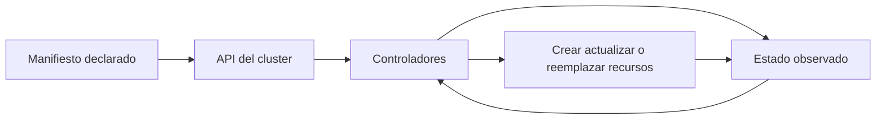
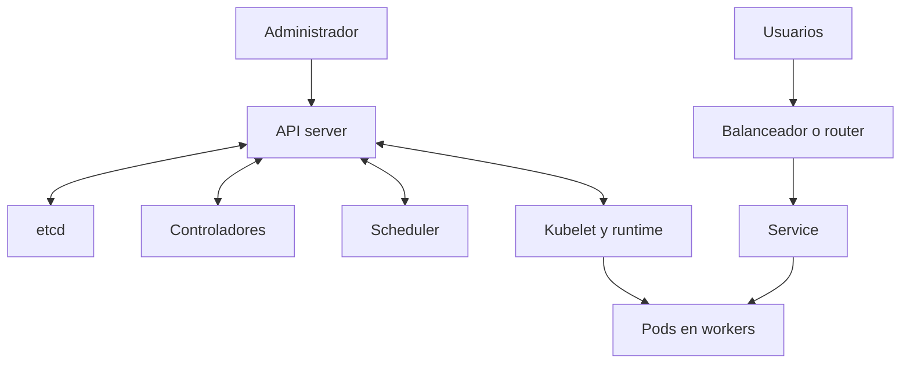
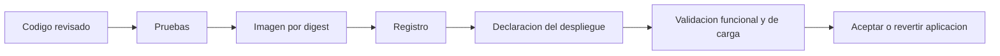
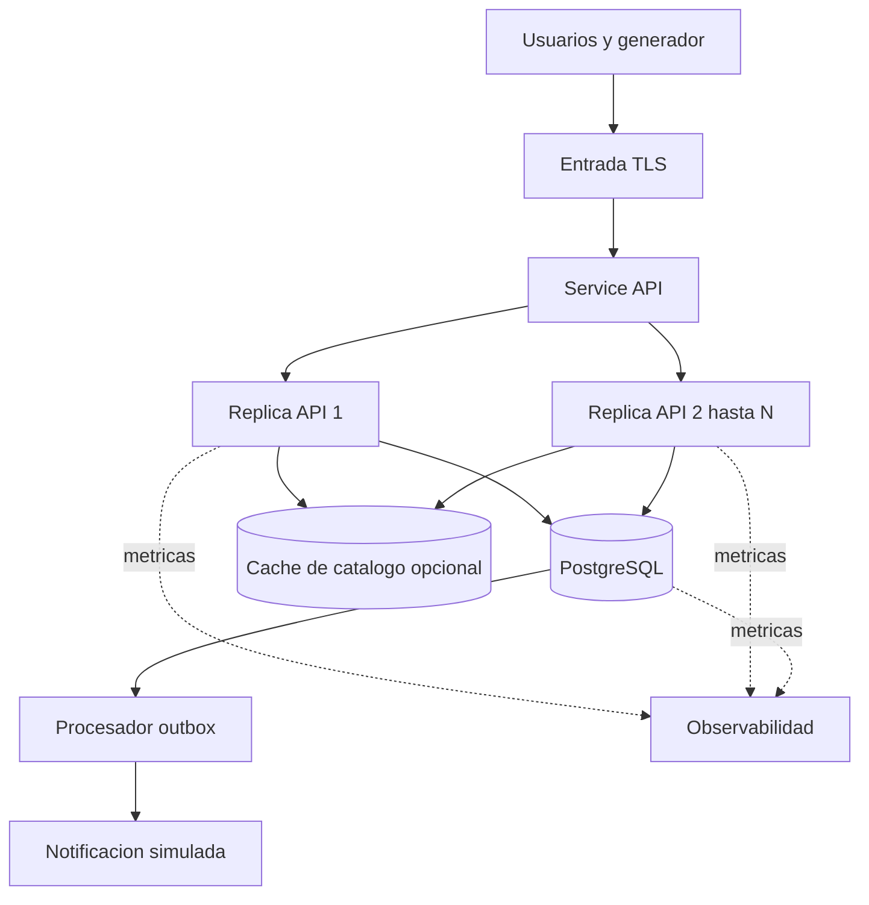
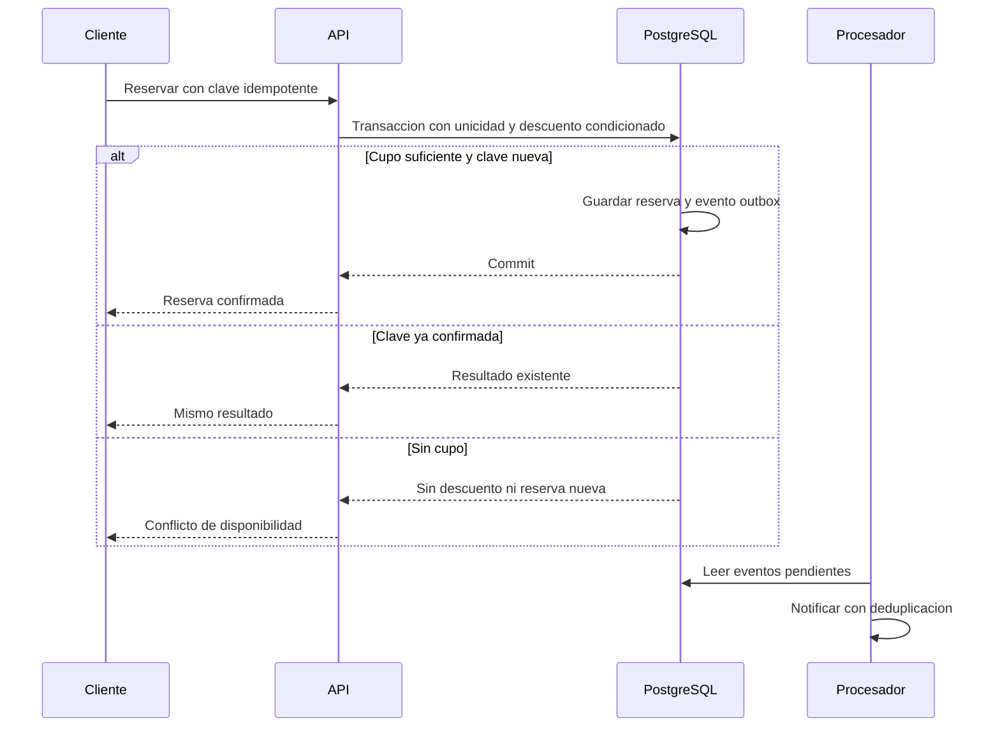
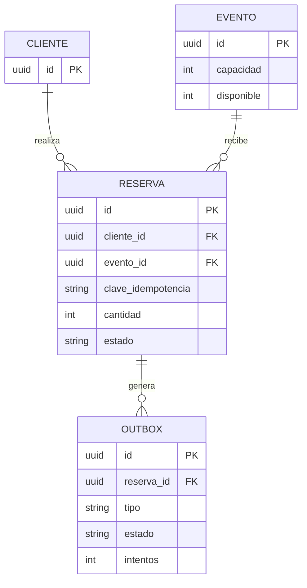

# Investigación integral de Kubernetes OKD y Red Hat OpenShift

**DOC-01-01 · Seminario Kubernetes y OpenShift · Fase 01**  
Versión documental 1.0 · Fecha de consulta 13 de octubre de 2026  
Dirigido a participantes del seminario, arquitectura, desarrollo y operaciones.

La recomendación es aprender primero el modelo declarativo de Kubernetes, experimentar con OKD cuando se necesiten las funciones de una plataforma integrada y evaluar Red Hat OpenShift cuando el soporte contractual, la certificación y la operación empresarial justifiquen su costo. La alta concurrencia debe demostrarse con pruebas de extremo a extremo: aumentar Pods no elimina por sí solo los límites de la base de datos ni los errores transaccionales.

Este documento desarrolla fundamentos, alternativas, instalación, operación y un caso de reservas bajo demanda intensa. Proporciona la base de investigación para los manuales y el laboratorio posteriores. El caso empresarial propuesto es un diseño verificable; sus cifras son objetivos o supuestos explícitos, no resultados ejecutados. Se incluye un antecedente empresarial publicado por Red Hat, separado de la propuesta del seminario.

## Índice

1. Propósito alcance y metodología
2. Contenedores virtualización y fundamentos cloud native
3. Kubernetes y el modelo declarativo
4. Arquitectura del clúster y plano de control
5. Objetos API y organización de recursos
6. Cargas de trabajo y ciclo de vida
7. Redes descubrimiento y exposición
8. Almacenamiento y persistencia
9. Configuración secretos y cadena de suministro
10. Seguridad identidad y aislamiento
11. Recursos planificación y escalamiento
12. Disponibilidad continuidad y recuperación
13. Observabilidad y diagnóstico
14. Entrega continua GitOps y Operators
15. OKD y su ecosistema comunitario
16. Red Hat OpenShift y operación empresarial
17. Comparación y criterios de selección
18. Laboratorio de una a cinco computadoras
19. Instalación configuración y validación
20. Caso empresarial de alta concurrencia
21. Plan de pruebas de carga estrés y resiliencia
22. Conclusiones decisiones y continuidad del seminario

Las referencias y el glosario se presentan después del capítulo 22. En Word, el índice es un campo actualizable a partir de los encabezados.

## 1 Propósito alcance y metodología

### Objetivos y preguntas de investigación

El seminario debe explicar qué hace Kubernetes, qué añade una distribución integrada y cuándo la inversión en una plataforma empresarial resulta razonable. Las preguntas centrales son cómo se mantiene una aplicación disponible, cómo se distribuye su ejecución, cómo se protege el estado del negocio y qué evidencia permite atribuir una mejora a la plataforma. Se busca que el participante pueda relacionar un requisito con un mecanismo y con una prueba observable.

La investigación cubre Kubernetes upstream, OKD y Red Hat OpenShift Container Platform. No supone equivalencia de versiones ni compatibilidad automática de todos sus complementos. Tampoco pretende que una laptop reproduzca las capacidades de un centro de datos. La implementación de la aplicación, los procedimientos detallados por sistema operativo y la presentación corresponden a las etapas prácticas posteriores.

### Método y vigencia

Se consultaron documentación oficial de Kubernetes, el proyecto OKD, Red Hat, CRC, kind, PostgreSQL y Grafana k6. Las referencias se identifican como [R01] a [R37], con URL y alcance. Las afirmaciones de producto se separan de recomendaciones de arquitectura y de supuestos del experimento. El caso publicado por un proveedor se considera evidencia de adopción, no un ensayo independiente de rendimiento.

Al corte de consulta, la página de versiones de Kubernetes muestra 1.37.1 como última versión publicada y mantiene las ramas 1.37, 1.36 y 1.35. OKD anuncia 5.0.0-okd-scos.0 con Kubernetes 1.36; OpenShift 4.22 documenta Kubernetes 1.35. Estas son referencias verificadas, no una afirmación de que las tres plataformas deban instalar la misma versión. Antes del laboratorio se congelará el parche, la arquitectura, el digest de imágenes y el conjunto de complementos. [R01, R02, R03]

La documentación bajo rutas `latest` puede cambiar. Para repetir el laboratorio habrá que conservar una ficha de versiones con enlaces específicos, fecha, verificaciones de descarga y configuración utilizada. Cuando las páginas discrepen, las notas del payload elegido y la documentación específica de esa versión deben guiar la decisión, comprobada luego sobre el clúster.

## 2 Contenedores virtualización y fundamentos cloud native

### Imagen contenedor y máquina virtual

Una imagen empaqueta archivos y dependencias de una aplicación; un contenedor es una ejecución de esa imagen con aislamiento del sistema operativo. Una máquina virtual incorpora su propio sistema invitado sobre un hipervisor. Los contenedores Linux comparten el kernel del host; por ello, empaquetar una aplicación no sustituye las decisiones sobre aislamiento, permisos y actualización del host. Kubernetes organiza cargas en contenedores, mientras el runtime ejecuta los contenedores en cada nodo. [R04, R05]

El flujo del seminario será código, construcción reproducible, imagen identificada por digest, registro y despliegue. Un tag como `latest` puede apuntar a contenido distinto con el tiempo; un digest permite identificar el contenido usado. No se reconstruirá una imagen para cada ambiente: se promoverá el mismo artefacto y se variará la configuración. [R05]

### Diseño de aplicaciones para distribución

Una API que guarda sesiones solamente en memoria del proceso se complica al tener varias réplicas. Para el caso propuesto, la identidad del cliente se verificará en cada solicitud y el estado persistente se conservará en un servicio de datos. Los archivos temporales se tratarán como descartables. Los cierres de proceso permitirán terminar solicitudes activas dentro de un plazo definido.

Los microservicios no son requisito para usar Kubernetes. Un monolito modular con límites claros, métricas y ejecución sin privilegios puede ser una mejor primera aplicación que numerosos servicios difíciles de observar. La recomendación didáctica es mantener dos componentes de aplicación, API y procesador asíncrono, y agregar complejidad solamente si una hipótesis experimental la necesita.

El beneficio esperado del empaquetado es reducir diferencias entre ambientes; no garantiza idéntico rendimiento. CPU, memoria, almacenamiento, kernel, red y datos siguen influyendo. La ficha de cada ensayo deberá registrar esas condiciones para distinguir un cambio de software de un cambio de infraestructura.

## 3 Kubernetes y el modelo declarativo

### Estado deseado y reconciliación

Kubernetes es una plataforma extensible para administrar cargas y servicios en contenedores mediante configuración declarativa y automatización. El usuario describe recursos y los controladores intentan llevar el estado observado al estado deseado. No es, por sí solo, una plataforma completa que imponga una única solución de integración continua, registro, monitoreo o base de datos. [R06]

Si un Deployment solicita tres réplicas y una desaparece, sus controladores intentan reponer la cantidad declarada. Ese proceso requiere que existan capacidad, conectividad y dependencias disponibles. No significa que una transacción interrumpida se repita correctamente: esa responsabilidad debe resolverse en la aplicación.

Figura 1. Bucle conceptual de reconciliación. Elaboración del seminario basada en [R04, R06].

### Motivos para adoptarlo y límites

Su adopción tiene sentido cuando el equipo administra múltiples servicios, realiza entregas frecuentes o necesita distribuir réplicas y automatizar recuperación. Permite expresar intención en recursos revisables y reutilizar una API común entre infraestructuras. La portabilidad depende también de los servicios externos y de las extensiones utilizadas.

No se recomienda introducir un clúster solo para resolver el despliegue de una aplicación pequeña y estable sin capacidad operativa. Una máquina virtual o un servicio administrado puede satisfacer el requisito con menos esfuerzo. La decisión debe comparar costos de operación y resultados del negocio, no solamente el número de funciones disponibles.

En el seminario se observará el estado mediante consultas, eventos y métricas. Se contrastará la recuperación automática con una ejecución de una sola instancia. El objetivo es explicar el mecanismo y su límite, no afirmar que cualquier carga mejora por estar contenida en Kubernetes.

## 4 Arquitectura del clúster y plano de control

### Componentes y responsabilidades

El plano de control incluye el servidor API, etcd, el scheduler y los controladores. La API recibe solicitudes; etcd conserva el estado del clúster; el scheduler selecciona nodos para Pods pendientes; los controladores reconcilian recursos. En los nodos, kubelet coordina la ejecución con el runtime. La implementación de red proporciona conectividad y puede implementar funciones de proxy con mecanismos distintos. [R04]

El tráfico de clientes de la aplicación normalmente entra por un balanceador o router y llega a los Pods. No debe pasar por el servidor API para cada operación del negocio. El plano de control administra la ejecución; el plano de datos transporta las solicitudes de la aplicación. Separar ambos ayuda a interpretar una falla: una API administrativa indisponible no implica necesariamente que todos los procesos ya iniciados dejen de atender.

Figura 2. Separación conceptual de administración y solicitudes de negocio. [R04, R10]

### Implicaciones operativas

El estado del negocio no debe almacenarse directamente en etcd. La base transaccional de reservas tiene su propio respaldo y recuperación. Los discos lentos o la presión del host pueden afectar al plano de control aun cuando la API de negocio tenga CPU libre. Por ello se registrará la utilización del host, no únicamente la de los Pods.

Tres nodos virtuales sobre una sola laptop permiten estudiar componentes, pero comparten disco, alimentación y red. Para demostrar tolerancia a la pérdida física de un equipo se necesitan dominios de falla separados. La arquitectura del laboratorio debe declarar cuál falla puede simular y cuál no puede representar.

## 5 Objetos API y organización de recursos

### Declaraciones identificables y revisables

Los objetos Kubernetes contienen información como `apiVersion`, `kind`, `metadata` y una especificación del estado deseado; muchos exponen además su estado observado. Los nombres identifican objetos dentro de su ámbito, y labels y selectores relacionan conjuntos de recursos. Namespaces permiten organizar recursos de ámbito limitado; no todos los recursos pertenecen a un Namespace. [R35]

Para el laboratorio se propone un Namespace `seminario`, etiquetas `app`, `component` y `environment`, y nombres que distingan API, procesador y datos. Los selectores se revisarán con especial cuidado: un selector incorrecto puede enviar tráfico al componente equivocado o dejar un Service sin destinos.

| Recurso | Intención en el seminario | Evidencia de validación |
| --- | --- | --- |
| Namespace | Separar el experimento | Contexto y ámbito correctos |
| Deployment | Mantener API replicada | Réplicas disponibles y revisión |
| Service | Dar acceso estable a la API | Endpoints y conexión |
| ConfigMap y Secret | Separar configuración | Valores y acceso controlado |
| PVC | Solicitar almacenamiento | Vinculación y persistencia |
| HPA | Ajustar réplicas | Métrica observada y cambios |

Tabla 1. Correspondencia propuesta entre intención y comprobación. [R07, R10, R12, R13, R14, R16]

### Disciplina de cambios

Los manifiestos deben ser legibles, pequeños y trazables. Antes de aplicarlos se comprobarán su versión API y sus permisos. En el laboratorio posterior, una revisión local del cambio permitirá anticipar recursos que se crearán o modificarán. Consultar recursos existentes es distinto de ejecutar una mutación.

Un resultado `Running` no bastará como aceptación. Se verificará que la aplicación responda, que las dependencias estén disponibles y que el cambio cumpla el requisito funcional. Para el seminario se conservarán manifiestos, identificadores de imagen y evidencia de estado antes y después de cada experimento. Esta disciplina facilita explicar por qué ocurrió un comportamiento sin depender de memoria o capturas aisladas.

## 6 Cargas de trabajo y ciclo de vida

### Selección de controladores

Un Pod agrupa uno o más contenedores que comparten ciertos recursos de ejecución. Es una unidad reemplazable, no un servidor permanente. Deployments administran actualizaciones de cargas sin identidad persistente por réplica; StatefulSets aportan identidad y asociación estable de almacenamiento para cargas que lo requieren. DaemonSets atienden ejecución por nodo; Jobs y CronJobs representan trabajo finito o programado. [R07, R08, R09]

El caso utilizará un Deployment para la API y otro para el procesador asíncrono. Se preferirá una base de datos externa para aislar el estudio de escalamiento de la aplicación. Si se incorpora una base dentro del clúster, su controlador u Operator deberá gestionar explícitamente replicación, respaldo y recuperación; un StatefulSet por sí solo no implementa esas funciones del motor. [R09, R23]

### Salud y actualización de versiones

La sonda de readiness indica si el Pod debe recibir tráfico; liveness detecta condiciones que justifican reiniciar el contenedor; startup protege el periodo de arranque antes de las otras sondas. Una liveness dependiente de una base saturada puede reiniciar todas las réplicas y agravar el incidente. [R08]

Se propone que `/health/live` compruebe la vida del proceso y `/health/ready` su aptitud para atender solicitudes, con tiempos y fallos tolerados documentados. Una dependencia externa lenta debe tener timeout y respuesta controlada. El cierre debe detener nuevas tareas y terminar las que estén en curso antes de agotar el periodo de gracia.

Un despliegue gradual crea y retira réplicas según la estrategia configurada. Su éxito requiere espacio para las nuevas instancias y compatibilidad entre versiones. Las migraciones de esquema deben admitir convivencia temporal. Revertir una imagen no deshace automáticamente una modificación destructiva de datos. La prueba posterior incluirá una versión deliberadamente no preparada y comprobará que no reciba solicitudes. [R07]

## 7 Redes descubrimiento y exposición

### Comunicación dentro y fuera del clúster

Un Service ofrece una abstracción estable para un conjunto cambiante de destinos. ClusterIP atiende acceso interno; otras modalidades permiten integrar exposición externa. DNS facilita descubrimiento sin fijar direcciones de Pods. El CNI y la configuración de red determinan la conectividad efectiva. Crear un Service no garantiza que exista un balanceador externo en un laboratorio local. [R10]

Ingress describe reglas HTTP y HTTPS y requiere un controlador. La API Ingress está congelada y Kubernetes recomienda considerar Gateway API para nuevas capacidades. La elección concreta debe respetar la implementación y versión disponibles. En OpenShift, Route es una extensión habitual para publicar aplicaciones mediante el router de la plataforma; no es un objeto estándar portable a cualquier Kubernetes. [R11, R24]

### Segmentación y validación

NetworkPolicy expresa reglas de tráfico para Pods seleccionados, pero requiere una implementación de red que las aplique. La ausencia de una política de aislamiento no equivale a una denegación por defecto. Se debe verificar el comportamiento con conexiones permitidas y rechazadas, incluido DNS. [R15]

Para el caso se propone permitir entrada a la API desde el router, acceso de API a PostgreSQL y caché, y acceso del procesador al repositorio de eventos. Se permitirán las consultas DNS necesarias. La base no se publicará como servicio accesible desde Internet.

La red del laboratorio utilizará rangos que no se solapen con LAN, VPN, Pods o Services. DNS, certificados y relojes se comprobarán antes de instalar. Para las pruebas se usará la misma ruta TLS que consumiría un cliente; una medición interna evita parte del costo del router y no representa el mismo experimento. También se registrarán ancho de banda, latencia y pérdida de paquetes, pues aumentar réplicas no compensa un enlace saturado.

## 8 Almacenamiento y persistencia

### Volúmenes y contratos de almacenamiento

Los volúmenes resuelven necesidades de datos dentro de la vida de un Pod o más allá de ella. Un PersistentVolume representa almacenamiento disponible y un PersistentVolumeClaim la solicitud del consumidor. StorageClass define clases y parámetros para aprovisionamiento; los controladores CSI integran proveedores de almacenamiento. Los modos de acceso y la topología condicionan dónde y cómo puede montarse un volumen. [R12]

ReadWriteOnce suele restringir montaje de escritura a un nodo, no necesariamente a un solo Pod. ReadWriteOncePod ofrece una semántica distinta y requiere soporte compatible. El modo elegido no convierte una base de datos en un sistema distribuido ni garantiza exclusión transaccional a nivel de negocio. [R12]

### Diseño de datos del experimento

PostgreSQL será la autoridad de reservas y disponibilidad. La caché solo acelerará consultas que toleren cierta antigüedad. El diseño del seminario no dependerá de que una caché confirme una venta. Los datos de prueba se regenerarán a partir de una semilla conocida y cada ensayo tendrá un conjunto de identificadores independiente.

Los volúmenes locales son útiles para aprendizaje, pero una falla del host puede impedir recuperar el volumen desde otro nodo. Si se afirma continuidad ante pérdida de un equipo, habrá que demostrar que el almacenamiento y su recuperación admiten esa falla. Se medirán latencias de disco y tiempo de recuperación con datos, no solo el arranque de un Pod vacío.

El respaldo debe incluir datos, configuración y un procedimiento de restauración. Un snapshot de volumen puede requerir coordinación con la base para ser consistente. El requisito del caso será comprobar reservas y saldos de inventario después de restaurar; conservar un archivo de copia sin probar su lectura no acredita recuperabilidad.

## 9 Configuración secretos y cadena de suministro

### Separación de parámetros y credenciales

ConfigMaps contienen configuración no confidencial; Secrets transportan valores sensibles. Codificar un Secret en base64 no lo cifra. La protección requiere permisos adecuados, manejo seguro y cifrado en reposo cuando corresponda. Los consumidores y los mecanismos de actualización determinan cuándo un cambio se hace visible en la aplicación. [R13, R14]

Para la API se propone usar parámetros de tiempos de espera, tamaño de pool y nivel de log en configuración, y credenciales de base mediante un mecanismo de secretos. La aplicación no deberá imprimirlas en excepciones ni incluirlas en respuestas de diagnóstico. La rotación se probará con credenciales de laboratorio y una ventana controlada.

### Artefactos verificables

La imagen se identificará por digest y se almacenará en un registro accesible para los nodos. Las políticas de descarga se fijarán explícitamente. Se conservarán versión de dependencias, origen del artefacto y resultado del análisis de vulnerabilidades. Kubernetes puede consumir imágenes, pero la aprobación de su contenido y la trazabilidad de la construcción requieren un proceso adicional. [R05]

Se propone producir una lista de componentes de software, validar el origen y definir responsables para reconstruir imágenes afectadas. El contenedor se diseñará para ejecutarse sin privilegios, escribir únicamente en rutas permitidas y funcionar con el UID asignado por la plataforma. La compatibilidad se verificará tanto en Kubernetes como en OKD antes de atribuir un fallo a diferencias del orquestador.

Los repositorios de manifiestos no contendrán contraseñas. Los archivos de evidencia excluirán tokens y datos personales. Para este entregable se mantiene todo en archivos locales; la publicación remota queda bajo el control del usuario.

## 10 Seguridad identidad y aislamiento

### Identidad y autorización

La autenticación establece quién realiza una solicitud; RBAC determina qué acciones puede ejecutar sobre qué recursos. Una ServiceAccount da identidad a una carga. Conceder `cluster-admin` a aplicaciones o usuarios habituales amplía innecesariamente el impacto de una credencial comprometida. Se recomienda el mínimo privilegio y revisar roles que permitan crear cargas o leer Secrets, pues pueden abrir caminos de escalamiento. [R17]

El laboratorio definirá funciones de administrador, desarrollador y lector de evidencia. El desarrollador podrá trabajar en el ámbito del seminario sin modificar infraestructura global. La API del negocio no necesitará acceder a la API Kubernetes; por tanto, se evitará montar un token de ServiceAccount si no lo requiere.

### Admisión y ejecución segura

Pod Security Standards y sus mecanismos de admisión ayudan a limitar configuraciones peligrosas. OpenShift incorpora Security Context Constraints para controlar aspectos como privilegios, usuarios y volúmenes. SCC y RBAC cumplen funciones relacionadas pero diferentes: uno regula condiciones de ejecución y el otro autoriza acciones sobre recursos. [R18, R25]

Se propone desactivar escalamiento de privilegios, eliminar capacidades innecesarias y utilizar perfiles seccomp compatibles. Cuando una imagen no funcione con un UID arbitrario, se revisarán permisos y rutas antes de abrir una excepción. Cualquier excepción tendrá justificación, ámbito mínimo y criterio de retiro.

Namespaces facilitan organización, pero no constituyen por sí solos una frontera suficiente entre adversarios. Deben combinarse con políticas de red, cuotas, seguridad de ejecución y controles de infraestructura. Para los datos del laboratorio se usarán identidades ficticias y límites de acceso. La seguridad se verificará intentando operaciones que cada rol debe tener prohibidas, además de comprobar el camino permitido.

## 11 Recursos planificación y escalamiento

### Capacidad y límites

Los requests ayudan al scheduler a colocar Pods según recursos solicitados; los limits restringen consumo. CPU puede sufrir throttling y memoria puede terminar en OOM cuando se exceden límites aplicables. Una asignación inadecuada puede producir Pods pendientes o degradación aunque el promedio de utilización parezca bajo. [R16]

Se propone medir una réplica antes de fijar sus valores. Como punto de partida experimental, la API podría solicitar 250 millicores y 256 MiB, con límites iniciales de 1 CPU y 512 MiB; estos son valores de ensayo, sujetos a profiling y no requisitos oficiales. Se anotará consumo bajo carga, tiempo de recolección de memoria y saturación del pool de conexiones.

### Escalamiento horizontal y sus condiciones

HPA ajusta réplicas usando métricas de recursos u otras métricas disponibles. Para utilización de CPU necesita requests adecuados y acceso a la API de métricas. Su acción ocurre en un bucle periódico y no es instantánea. La disponibilidad de nodos es una cuestión separada: aumentar réplicas no crea capacidad física por sí mismo. [R19]

La configuración propuesta es un mínimo de dos réplicas y un máximo inicial de doce, objetivo de CPU de 60 por ciento y reducción estabilizada. Se estudiará luego si CPU representa adecuadamente el cuello de botella o si conviene escalar por solicitudes o cola. Si la base ya está saturada, crear más réplicas puede empeorar la presión.

Ejemplo de dimensionamiento, pendiente de medición: si una réplica sostiene 100 solicitudes por segundo cumpliendo el objetivo de latencia y el pico esperado es 600, seis réplicas cubren el valor nominal. Añadir 25 por ciento de margen lleva a ocho por redondeo. El cálculo no prueba escalabilidad lineal; deberán contrastarse ocho réplicas con la misma base, red y perfil de solicitudes.

## 12 Disponibilidad continuidad y recuperación

### Redundancia con dominios de falla reales

Para el plano de control, kubeadm documenta topologías de alta disponibilidad con etcd integrado o externo y un endpoint estable para el API server. La topología elegida debe mantener quorum y conectividad. Un conjunto de tres miembros permite normalmente tolerar la pérdida de uno; la ubicación física determina si una falla afecta a varios simultáneamente. [R20]

Para la API se propone repartir réplicas entre nodos y mantener capacidad después de perder un worker. Un PodDisruptionBudget limita ciertas interrupciones voluntarias, como evacuaciones mediante la API correspondiente. No evita averías físicas ni garantiza continuidad de una transacción; tampoco controla directamente todos los mecanismos de actualización de cargas. [R21]

### Respaldo recuperación y objetivos

RTO es el tiempo objetivo para restaurar un servicio; RPO es la pérdida máxima de datos aceptable expresada como intervalo. Para el laboratorio se propone RTO de diez minutos y RPO de cinco minutos en una restauración de datos; son metas didácticas que deben negociarse para producción. La recuperación de una réplica de API se medirá por separado y tendrá una meta experimental de 60 segundos.

El respaldo de etcd recupera el estado del clúster, no el contenido de todos los volúmenes ni las bases externas. Red Hat exige restaurar desde un respaldo correspondiente a la misma versión z-stream y presenta esa restauración como un procedimiento de último recurso. El plan debe respaldar también aplicación, datos y secretos de recuperación. [R26]

Se ensayarán fallas de Pod, pérdida de worker y restauración de base como escenarios diferentes. Cada uno tendrá reloj de inicio, condición de recuperación y validación de integridad. Una respuesta HTTP exitosa no basta si existe una reserva duplicada. Tampoco se confundirá recuperación regional con reinicio local: un segundo centro necesita replicación, DNS y procedimientos propios.

## 13 Observabilidad y diagnóstico

### Qué observar y por qué

Métricas, logs y trazas ofrecen perspectivas complementarias. Las métricas muestran tendencias y alertas; los logs describen eventos; las trazas siguen operaciones entre componentes. Kubernetes aporta puntos de integración, pero la instrumentación y retención de la aplicación requieren diseño. [R22]

Se medirán latencia p50, p95 y p99, tasa de errores, throughput útil, solicitudes en curso, CPU, memoria, reinicios y Pods pendientes. En PostgreSQL se observarán conexiones, tiempos de consulta y bloqueos. En procesos asíncronos se registrará antigüedad del evento más antiguo, no solo cantidad de eventos. El identificador de solicitud permitirá correlacionar router, API y procesamiento sin registrar credenciales.

### Secuencia de diagnóstico propuesta

Ante una solicitud fallida, el participante comprobará primero alcance y hora del incidente, después DNS y TLS, destinos del Service, readiness y eventos del Pod. Si hay respuestas pero latencia elevada, contrastará métricas de API, base y generador. Si hay Pods pendientes, revisará requests, capacidad y restricciones de colocación. Este orden evita atribuir todos los síntomas al contenedor.

En el caso propuesto, una alerta combinará incremento sostenido de errores con degradación de latencia; otra advertirá saturación del pool o retraso del procesador. Se definirán umbrales y duración para evitar alertar por un único pico esperado. El tablero mostrará tanto la tasa enviada como la completada y las operaciones de negocio confirmadas.

La retención se dimensionará para conservar todas las repeticiones del ensayo y su periodo de calentamiento. Las capturas serán apoyo visual; las series y resultados originales deberán permanecer disponibles para reconstruir percentiles y comparar versiones. Un panel vacío no se considerará evidencia de salud hasta verificar que la fuente de métricas esté funcionando.

## 14 Entrega continua GitOps y Operators

### Del código a una versión desplegada

Se propone un flujo con revisión de código, pruebas funcionales, construcción única, análisis del artefacto, publicación en registro y promoción por ambiente. Las pruebas deberán proteger las reglas transaccionales del caso. La misma imagen se desplegará en línea base y plataforma, con diferencias documentadas en configuración y recursos.

GitOps puede utilizar un repositorio como declaración de intención y un reconciliador para aplicar cambios y detectar desvíos. Es un patrón propuesto para etapas posteriores; no se requiere instalarlo para comprender Kubernetes. El historial de archivos permite relacionar cambio y despliegue, pero necesita permisos y separación de secretos. Ninguna publicación remota se ejecuta como parte de esta investigación.

Figura 3. Flujo propuesto de entrega y aceptación. Elaboración del seminario.

### Operators y responsabilidad operativa

Un Operator combina recursos personalizados y lógica de control para automatizar conocimiento de un dominio. Puede gestionar instalación y mantenimiento de una base o servicio, pero sus capacidades dependen de su implementación. CRD extiende el esquema API y no es, por sí misma, la lógica que ejecuta la operación. [R23]

Antes de instalar un Operator se revisarán permisos, versiones soportadas, respaldo, actualizaciones y comportamiento ante fallas. Su instalación no transfiere toda responsabilidad a la plataforma. En el laboratorio se comenzará con pocos componentes para poder observarlos; después se comparará el manejo manual de un recurso con un controlador que automatice una tarea concreta. Las migraciones de datos seguirán una estrategia compatible hacia adelante y atrás durante la convivencia de versiones.

## 15 OKD y su ecosistema comunitario

### Qué aporta y cómo se relaciona con OpenShift

OKD es una distribución de Kubernetes orientada al desarrollo continuo y al despliegue multiusuario, con herramientas integradas para desarrolladores y operadores. El proyecto se describe como distribución hermana de Red Hat OpenShift; no debe presentarse como una suscripción empresarial gratuita con el mismo contrato de soporte o certificación. [R27]

Las notas del 17 de septiembre de 2026 identifican el payload `5.0.0-okd-scos.0`, Kubernetes 1.36 y CentOS Stream CoreOS 10. El portal anuncia 5.0 como versión actual y 5.1 como candidato de ingeniería. No se utilizará un candidato solo por su numeración más reciente. [R02, R27]

### Precauciones de documentación y operación

La documentación `latest` consultada de OKD todavía contiene referencias a Fedora CoreOS en arquitectura e instalación, mientras las notas de 5.0 especifican SCOS. Esta discrepancia debe resolverse al seleccionar el payload: no se intercambiarán imágenes de sistema operativo, instaladores o instrucciones de ramas históricas. El registro de versión del laboratorio deberá indicar qué notas y activos se usaron. [R02, R28]

En septiembre de 2026 el proyecto anunció un servicio de actualizaciones Cincinnati propio para OKD y payloads SCOS. La presencia de una ruta sugerida no elimina la necesidad de revisar salud, restricciones y compatibilidad antes de actualizar. [R29]

Se recomienda OKD para aprender consola, proyectos, rutas y reconciliación de plataforma cuando exista capacidad suficiente y tiempo para resolver incidencias comunitarias. No tener un costo de suscripción para el proyecto no equivale a costo total cero: habrá consumo eléctrico, almacenamiento, actualizaciones, investigación y horas de operación. La idoneidad para una empresa depende de su tolerancia al riesgo y de su capacidad para sostener ese trabajo.

## 16 Red Hat OpenShift y operación empresarial

### Plataforma integrada

OpenShift Container Platform integra Kubernetes con componentes y procesos para administrar una plataforma de aplicaciones. Su arquitectura incorpora servicios de plataforma, consola, CLI `oc` y Operators. La combinación reduce decisiones de integración, aunque exige conocer su modelo de operación y las compatibilidades del producto. [R24]

Las notas de OpenShift 4.22 especifican Kubernetes 1.35, runtime CRI-O y uso de RHCOS en control plane y compute. No debe trasladarse a 4.22 la posibilidad de workers RHEL encontrada en documentación de versiones anteriores. Las extensiones y productos dependientes tienen matrices y ciclos de soporte que deben revisarse por separado. [R03]

### Valor y condiciones de adopción

La propuesta de valor empresarial consiste en una plataforma mantenida, soporte contractual según suscripción y un ecosistema de componentes certificados. Eso no convierte una aplicación mal diseñada en una aplicación disponible ni sustituye al equipo de operación. Para seleccionar producto y modalidad deben confirmarse alcance de soporte, infraestructura admitida y complementos contratados. [R24, R27]

Se propone evaluar OpenShift cuando el costo de integrar y mantener múltiples componentes, o el impacto de una indisponibilidad, sea elevado. El análisis deberá incluir administradores, guardias, formación, actualizaciones, capacidad y recuperación. Si una organización ya dispone de una plataforma Kubernetes gestionada que satisface esos requisitos, OpenShift debe aportar una mejora demostrable para justificar una migración.

En infraestructura híbrida se recomienda comenzar con clústeres y dependencias bien delimitados. Distribuir un mismo sistema entre sedes añade latencia y fallas parciales. Se definirán ubicación del dato autoritativo, conectividad privada y recuperación antes de distribuir componentes. El seminario demostrará una base de diseño; no prometerá portabilidad sin cambios de Route, almacenamiento o identidad.

## 17 Comparación y criterios de selección

### Diferencias que afectan una decisión

La comparación distingue proyecto de orquestación, distribución comunitaria y producto empresarial. Los tres comparten conceptos Kubernetes, pero su operación y respaldo difieren. Las capacidades de una instalación upstream dependen de los componentes que el equipo seleccione. Las características específicas de OKD y OpenShift deben comprobarse en su versión. [R06, R24, R27]

| Criterio | Kubernetes upstream | OKD | Red Hat OpenShift |
| --- | --- | --- | --- |
| Naturaleza | Proyecto de orquestación | Distribución comunitaria integrada | Producto empresarial integrado |
| Soporte | Comunidad o proveedor elegido | Comunidad del proyecto | Contrato según suscripción |
| Integración | La define el operador | Herramientas de plataforma | Integración y ciclo de producto |
| Exposición HTTP | Controlador elegido | Rutas y componentes de plataforma | Rutas y componentes soportados |
| Sistema de nodos | Según distribución y soporte | SCOS en payload 5.0 consultado | RHCOS en 4.22 consultado |
| Operación | Selección y mantenimiento propios | Mantenimiento comunitario | Procedimientos y matriz empresarial |
| Costo | Infraestructura y operación | Infraestructura y operación | Lo anterior más suscripción aplicable |
| Uso didáctico | Comprender fundamentos | Aprender plataforma integrada | Evaluar operación empresarial |

Tabla 2. Comparación cualitativa con referencias de versión. [R02, R03, R06, R24, R27]

### Matriz de decisión propuesta

La empresa calificará cada alternativa de uno a cinco, con evidencias para cada puntaje. Se proponen pesos de 25 por ciento para soporte y continuidad, 20 para costo total a tres años, 20 para capacidad operativa del equipo, 15 para integración y experiencia de desarrollo, 10 para compatibilidad y 10 para requisitos de infraestructura. La puntuación ponderada suma peso por calificación dividido entre cinco. Estos pesos son una herramienta propuesta, no una clasificación oficial.

No se asignan puntajes definitivos sin inventario, cotización y prueba. La sensibilidad se estudiará variando los dos pesos principales: si una pequeña variación cambia al ganador, la decisión necesita más evidencia. También existen criterios excluyentes: una plataforma incompatible con el hipervisor o sin soporte exigido no debe ganar por promedio.

Se recomienda Kubernetes con kind para comenzar, OKD para practicar funciones integradas con capacidad suficiente y una evaluación de OpenShift para requisitos empresariales. El salto a producción dependerá de pruebas, costos y soporte, no de una preferencia derivada del laboratorio.

## 18 Laboratorio de una a cinco computadoras

### Escenarios y capacidad

El número de equipos no determina por sí solo la viabilidad. Deben conocerse RAM utilizable, virtualización, CPU, disco SSD, red y sistema anfitrión. kind ejecuta nodos Kubernetes como contenedores y sirve para desarrollo y pruebas locales. CRC permite experimentar con un clúster local y documenta un preset OKD; la versión de su bundle puede diferir de la versión actual del proyecto. [R30, R31]

| Equipos disponibles | Diseño propuesto | Qué puede comprobarse |
| --- | --- | --- |
| Una laptop | kind y generador de carga limitado | Objetos, despliegue y recuperación de Pods |
| Dos equipos | Clúster local en uno y carga en otro | Separación del generador y aplicación |
| Tres equipos | VMs distribuidas y carga externa si cabe | Diferencias entre host y nodo; HA condicionada |
| Cuatro equipos | Tres hosts de clúster y uno de pruebas | Pérdida física de un host si hay quorum y capacidad |
| Cinco equipos | Tres hosts de clúster, uno de datos y uno de carga | Aislar mejor API, datos y generación |

Tabla 3. Escenarios didácticos sujetos al inventario real.

### Presupuesto preliminar y restricciones

Para kind se propone comenzar con una laptop de 16 GB de RAM y SSD, reservando margen al sistema anfitrión; es una recomendación experimental, no mínimo oficial universal. Si se pretende ejecutar una plataforma integrada en VMs, se necesitará un presupuesto mayor. La guía de bare metal de OpenShift 4.22 indica por máquina 4 CPU, 16 GB de RAM y 100 GB de disco para control plane; compute exige 2 CPU, 8 GB y 100 GB. También lista bootstrap con 4 CPU, 16 GB y 100 GB para el método que lo utiliza. [R32]

Como ejemplo aritmético, tres control planes y dos workers suman 16 CPU, 64 GB de RAM y 500 GB de discos virtuales, antes de hipervisores, bootstrap temporal, datos y generador. Tres nodos compactos requieren dimensionar además las cargas que compartirán control plane. Estas cifras no certifican que un conjunto de laptops sea una infraestructura soportada ni que cumpla el rendimiento de disco.

Se propone LAN cableada, direcciones estables y energía continua durante ensayos. La suspensión de una laptop invalida una prueba de estabilidad. Si no existe capacidad, se conservará la ruta con kind y se aplazará la demostración de HA física; no se reducirá memoria por debajo de requisitos esperando que el resultado represente una instalación válida.

## 19 Instalación configuración y validación

### Secuencia de implementación para las etapas prácticas

La investigación establece esta secuencia: inventariar equipos; seleccionar versión y topología; comprobar virtualización y red; preparar nombres y certificados; verificar activos de instalación; crear clúster; configurar almacenamiento, identidad y políticas; desplegar una aplicación mínima; observarla y comprobar recuperación. Los comandos definitivos deberán adaptarse al sistema anfitrión y al método elegido.

Para Kubernetes local se recomienda kind, fijando imagen de nodo compatible. Para estudiar instalación de un clúster de VMs se considerará kubeadm y un CNI explícito. Para OKD y OpenShift se elegirá un método documentado compatible con la infraestructura, como aprovisionamiento por instalador o por usuario. No son procedimientos intercambiables. [R20, R24, R30]

CRC documenta `crc setup` y `crc start`, y para OKD el ajuste `crc config set preset okd`. Ese camino es una alternativa local de aprendizaje, no un procedimiento para un clúster multinodo ni una garantía de bundle 5.0. Se comprobará disponibilidad de bundle y requisitos de la versión descargada antes de usarlo. [R31]

### Puertas de validación

| Momento | Condición para continuar | Evidencia a conservar |
| --- | --- | --- |
| Antes de instalar | RAM, disco, CPU y red suficientes | Inventario y presupuesto |
| Clúster creado | Nodos preparados y control estable | Versiones, condiciones y eventos |
| Servicios base | DNS, almacenamiento y acceso correctos | Conexiones y prueba de persistencia |
| Seguridad | Roles y políticas funcionan | Pruebas permitidas y denegadas |
| Aplicación | Lectura y reserva válidas por TLS | Respuestas e integridad de datos |
| Operación | Métricas y recuperación observables | Series, tiempos e incidentes |

Tabla 4. Validación propuesta para construir un manual ejecutable.

Antes de pruebas de carga se confirmará sincronización horaria y exportación de métricas. Si un Operator o nodo está degradado, se resolverá la causa primero. Los eventos se conservarán antes de reiniciar componentes, porque pueden explicar pérdida de conectividad, falta de espacio o errores de imagen. Instalar con éxito solo es el inicio; la aceptación requiere una carga útil y una recuperación comprobada.

## 20 Caso empresarial de alta concurrencia

### Antecedente publicado y problema propuesto

El caso HKT publicado por Red Hat en 2021 describe una plataforma local basada en OpenShift para servicios digitales, comercio electrónico e integración con ePay. Reporta adaptación a picos estacionales y promocionales mediante escalamiento automático, y reducción del plazo de introducción de servicios de cuatro semanas a una. Es un caso del proveedor y del cliente; no ofrece un benchmark reproducible comparable al laboratorio ni demuestra un multiplicador de throughput. [R33]

Para el seminario se propone una empresa ficticia que abre reservas de entradas con inventario limitado. En un evento promocional muchos usuarios consultan y reservan simultáneamente. El problema incluye latencia, recuperación y prevención de sobreventa. La hipótesis es que réplicas de API bien distribuidas permiten atender más solicitudes útiles y recuperar fallas, siempre que el servicio de datos y la lógica transaccional conserven capacidad e integridad.

### Requisitos y arquitectura de la aplicación

Se propone una API de catálogo, disponibilidad y reservas; PostgreSQL como fuente de verdad; caché opcional para catálogo; y un procesador de notificaciones. El procesador leerá una tabla outbox escrita en la misma transacción que confirma la reserva. No se requerirá una cola externa en la primera versión. La API será reemplazable y no almacenará sesiones locales indispensables.

| Operación propuesta | Contrato funcional | Resultado comprobable |
| --- | --- | --- |
| GET /catalogo | Listar eventos de prueba | Datos y código 200 |
| GET /eventos/id/disponibilidad | Consultar cupo | Cantidad informativa |
| POST /reservas | Clave idempotente y cantidad positiva | 201 creada, 200 repetida o 409 sin cupo |
| GET /reservas/id | Consultar estado propio | Reserva consistente |
| GET /health/ready | Indicar aptitud para recibir tráfico | Estado preparado o no preparado |

Tabla 5. Contrato propuesto; autenticación y validación de entrada se detallarán en el manual de aplicación.

Figura 4. Arquitectura propuesta del caso; no representa una implementación ya ejecutada.

### Integridad y concurrencia de reservas

Una consulta de disponibilidad seguida por una escritura independiente permite carreras. Se propone una transacción que descuente cupo solo si el valor disponible es al menos la cantidad solicitada, compruebe filas afectadas y cree reserva y evento outbox antes del commit. Si falla alguna parte, se revierte la transacción. La restricción de unicidad sobre cliente y clave idempotente evita duplicar el efecto de reintentos; una clave repetida con contenido distinto se rechazará. El diseño se apoya en transacciones y restricciones de PostgreSQL, cuya interacción deberá verificarse al implementar. [R36, R37]

La implementación deberá manejar la carrera por una misma clave: consultar una clave inexistente no basta. La inserción protegida por unicidad y la transacción decidirán un único ganador; el perdedor devolverá el resultado ya confirmado cuando esté disponible. Si la respuesta se pierde después del commit, el cliente podrá reintentar con la misma clave. No se prometerá entrega exactamente una vez para notificaciones: el receptor simulado deduplicará por identificador de evento.

Figura 5. Secuencia funcional propuesta. Debe validarse con pruebas de carreras y reintentos.

Figura 6. Modelo de datos propuesto. Restricción adicional: unicidad de cliente y clave idempotente; cantidades positivas; disponible entre cero y capacidad.

### Objetivos de servicio y dimensionamiento

Se propone medir un flujo con 80 por ciento de consultas de catálogo, 15 por ciento de disponibilidad y 5 por ciento de reservas. Como meta inicial, se evaluarán 600 solicitudes por segundo durante 15 minutos, p95 menor o igual a 300 ms para lecturas y 800 ms para reservas, y menos de 1 por ciento de fallos inesperados. Los 409 por inventario agotado se reportarán como resultados de negocio separados de errores técnicos.

Con 600 solicitudes por segundo y un tiempo medio hipotético de 0,2 segundos, la ley de Little estima 120 solicitudes en curso en un sistema estable, sin incorporar tiempo de reflexión del usuario. Esto no equivale a 120 usuarios ni a 120 conexiones de base. La concurrencia de clientes se medirá también mediante escenarios de usuarios virtuales.

Si cada réplica admite hasta diez conexiones de base y el máximo es doce réplicas, solo la API podría abrir 120 conexiones. La base deberá reservar capacidad adicional para procesadores, administración y mantenimiento. Por ello se limitarán pools y se observará espera, no solo el número de Pods. El presupuesto de CPU y memoria deberá soportar también nuevas réplicas durante actualizaciones.

### Viabilidad empresarial y riesgos

El costo total propuesto a tres años sumará hardware o consumo de nube, energía, almacenamiento, respaldos, suscripción si aplica, formación y horas de operación. El beneficio se estimará mediante reducción de incidentes, tiempo de despliegue y reservas válidas completadas en campañas. Sin costos reales ni volúmenes históricos no se calculará un retorno monetario definitivo.

| Riesgo del diseño | Consecuencia | Control y prueba propuesta |
| --- | --- | --- |
| Base saturada | Latencia y errores | Pools limitados y métricas de espera |
| Reintento tras commit | Reserva duplicada | Unicidad e idempotencia concurrente |
| Pérdida de worker | Menor capacidad | Distribución y capacidad restante |
| Caché antigua | Disponibilidad informativa errónea | Confirmación transaccional en base |
| Notificación repetida | Efectos duplicados | Outbox y deduplicación |
| Versiones incompatibles | Fallo de actualización | Prueba previa y esquema compatible |

Tabla 6. Riesgos y mecanismos que se validarán, no garantías asumidas.

## 21 Plan de pruebas de carga estrés y resiliencia

### Diseño del experimento y comparación justa

Se compararán una instancia, varias réplicas fijas y HPA usando la misma imagen, datos iniciales, mezcla de operaciones y presupuesto de recursos declarado. Para comparar distribución con una sola instancia se reportará tanto capacidad total igualada como capacidad adicional; de otro modo se atribuiría a la plataforma una mejora causada por asignar más CPU. La caché se mantendrá en el mismo estado o se declarará explícitamente fría o caliente.

Un modelo cerrado fija usuarios virtuales y puede disminuir su tasa cuando la aplicación se vuelve lenta. Un modelo abierto fija llegadas, separando esa tasa del tiempo de finalización. k6 documenta esta diferencia; ambos responden preguntas distintas. Se propone usar llegadas para capacidad sostenida y usuarios virtuales para experiencia de concurrencia. [R34]

Se registrarán versión de generador, reloj, CPU, red, solicitudes programadas, iniciadas, completadas y descartadas. Si el generador no sostiene la tasa, el ensayo se considerará limitado por el cliente y no demostrará capacidad del servidor. Cada escenario comenzará después de verificar salud y restaurar datos de prueba.

### Escenarios y criterios de aceptación

| Ensayo | Perfil propuesto | Qué demuestra |
| --- | --- | --- |
| Funcional | Flujo completo con baja carga | Contratos y persistencia |
| Carga escalonada | 100, 200, 400 y 600 solicitudes por segundo; 5 min por nivel | Curva de capacidad y latencia |
| Sostenida | 600 por segundo; 5 min de calentamiento y 15 de medición | Objetivos del caso |
| Estrés | Aumentos de 100 por segundo cada 5 min tras la meta | Punto de incumplimiento y recuperación |
| Pico | De 100 a 600 por segundo en 10 s; mantener 5 min | Reacción y retraso de HPA |
| Resistencia | 200 por segundo durante 2 h | Fugas y acumulación |
| Falla de Pod | Retirar una réplica durante carga estable | Recuperación de aplicación |
| Falla de worker | Apagar un host del laboratorio multinodo | Distribución y capacidad restante |
| Carrera de inventario | Más reservas simultáneas que cupo | Ausencia de sobreventa |
| Idempotencia | Repetir la misma clave en paralelo y tras timeout | Un solo efecto confirmado |
| Restauración | Recuperar datos desde respaldo | RTO, RPO e integridad |

Tabla 7. Plan experimental propuesto; las tasas se ajustarán a la capacidad real del laboratorio.

La prueba de integridad iniciará con un cupo de 1 000 unidades y solicitudes concurrentes de cantidades conocidas. Después se verificará que suma de cantidades confirmadas más disponible sea igual a capacidad, que disponible no sea negativo y que no existan claves duplicadas por cliente. También se comprobará que ningún evento outbox confirmado carezca de reserva y que reservas aceptadas por la API sean recuperables mediante consulta.

Los percentiles se calcularán sobre muestras individuales o histogramas compatibles. No se promediarán percentiles de ejecuciones para producir un percentil global. Se presentarán por endpoint y por repetición, con número de muestras, duración y tasa efectiva. Los errores de negocio se separarán de timeouts, respuestas 5xx y fallos de conexión.

### Evidencia y límites de interpretación

Cada escenario tendrá al menos tres repeticiones, con orden alternado de variantes cuando sea viable y tiempo de estabilización. Se registrarán cambios de réplicas, eventos, presión de memoria, throttling y consultas lentas. Si hay alta variabilidad, se explicará y se repetirá el escenario después de resolver la causa; no se escogerá solamente el mejor resultado.

El criterio de éxito combina latencia, fallos inesperados e integridad. Aumentar throughput con sobreventa es un fallo. La recuperación exige retornar al objetivo de servicio, no solo observar un Pod `Running`. La resistencia de dos horas es una prueba didáctica y no acredita operación continua anual.

La tabla de resultados que se llenará en la fase práctica contendrá identificador de ensayo, plataforma y parche, digest, recursos, réplicas mínimas y máximas, carga enviada y útil, p95 y p99 por operación, errores técnicos, conflictos de negocio, recuperación e invariantes de datos. En esta Fase 01 todos esos resultados permanecen pendientes de ejecución. Una laptop permite encontrar defectos y comprender mecanismos; no permite extrapolar directamente capacidad de una infraestructura empresarial.

## 22 Conclusiones decisiones y continuidad del seminario

### Conclusiones de investigación

Kubernetes proporciona un modelo común para declarar y reconciliar cargas; OKD añade una plataforma comunitaria integrada; OpenShift ofrece una distribución empresarial cuyo soporte y compatibilidad se deben evaluar según contrato y versión. La elección debe corresponder al problema y a la capacidad operativa del equipo. Las diferencias actuales de versiones y sistemas base hacen necesario fijar activos antes de redactar comandos definitivos.

La concurrencia es una propiedad del sistema completo. Réplicas, distribución y escalamiento pueden mejorar capacidad y recuperación, mientras la base, la red y las reglas transaccionales continúan imponiendo límites. El caso de reservas permite demostrar esas relaciones porque incluye una condición de integridad que debe mantenerse aun bajo reintentos y fallas. El antecedente HKT respalda la pertinencia empresarial del tema, pero no reemplaza las mediciones del seminario.

### Decisiones propuestas y siguiente puerta

Se propone adoptar kind como primer ambiente, preparar un inventario para decidir viabilidad de OKD y mantener OpenShift como alternativa de evaluación empresarial. La aplicación inicial tendrá API sin estado local, PostgreSQL y procesador outbox; caché será opcional y se medirá por separado. El plan de pruebas combinará contratos funcionales, integridad, carga, estrés y recuperación.

| Etapa posterior propuesta | Entrada necesaria | Entregable esperado |
| --- | --- | --- |
| Diseño de laboratorio | Inventario y topología elegida | Arquitectura y presupuesto |
| Instalación | Versiones congeladas y red preparada | Manual paso a paso y validaciones |
| Aplicación | Contratos e invariantes del caso | Código y despliegue local reproducible |
| Pruebas | Ambiente saludable e instrumentado | Evidencias y resultados comparativos |
| Presentación | Resultados revisados | Diapositivas y demostración |

Tabla 8. Continuidad propuesta; la investigación no acredita instalación ni pruebas ejecutadas.

La revisión de Fase 01 debe aceptar cobertura conceptual, comparación, fuentes, arquitectura propuesta y criterios de éxito. Antes de la etapa de instalación se requieren RAM, CPU, disco, sistema operativo y red de cada equipo, además de la decisión sobre uso de evaluación comercial. Los objetivos de carga se ajustarán al inventario sin convertir cifras hipotéticas en resultados. La Fase 00 se considera aprobada conforme a la instrucción del usuario; este documento queda disponible para su revisión de Fase 01.

## Referencias

Todas las fuentes siguientes son oficiales de sus respectivos proyectos o proveedores y fueron consultadas el 13 de octubre de 2026. Los contenidos se sintetizan; no se reproducen extensamente. Las rutas `latest` y las páginas de versiones pueden cambiar.

- [R01] Kubernetes. Releases. Ramas y parches publicados. https://kubernetes.io/releases/
- [R02] OKD. OKD 5.0 Release Notes, 17 de septiembre de 2026. Payload, Kubernetes y SCOS. https://okd.io/blog/2026/09/17/okd-5.0-release-notes/
- [R03] Red Hat. OpenShift Container Platform 4.22 release notes. Base Kubernetes, RHCOS y compatibilidad. https://docs.redhat.com/en/documentation/openshift_container_platform/4.22/html/release_notes/ocp-4-22-release-notes
- [R04] Kubernetes. Kubernetes Components. Responsabilidades del plano de control y nodos. https://kubernetes.io/docs/concepts/overview/components/
- [R05] Kubernetes. Images. Tags, digests y descarga. https://kubernetes.io/docs/concepts/containers/images/
- [R06] Kubernetes. Overview. Alcance de la plataforma y organización declarativa. https://kubernetes.io/docs/concepts/overview/
- [R07] Kubernetes. Deployments. Réplicas y actualizaciones. https://kubernetes.io/docs/concepts/workloads/controllers/deployment/
- [R08] Kubernetes. Pod Lifecycle. Estados, terminación y sondas. https://kubernetes.io/docs/concepts/workloads/pods/pod-lifecycle/
- [R09] Kubernetes. StatefulSets. Identidad y almacenamiento de cargas con estado. https://kubernetes.io/docs/concepts/workloads/controllers/statefulset/
- [R10] Kubernetes. Service. Descubrimiento y exposición. https://kubernetes.io/docs/concepts/services-networking/service/
- [R11] Kubernetes. Ingress. Controladores y relación con Gateway API. https://kubernetes.io/docs/concepts/services-networking/ingress/
- [R12] Kubernetes. Persistent Volumes. PV, PVC, modos de acceso y clases. https://kubernetes.io/docs/concepts/storage/persistent-volumes/
- [R13] Kubernetes. ConfigMaps. Configuración no confidencial. https://kubernetes.io/docs/concepts/configuration/configmap/
- [R14] Kubernetes. Secrets. Datos sensibles y límites de protección. https://kubernetes.io/docs/concepts/configuration/secret/
- [R15] Kubernetes. Network Policies. Selección, aislamiento e implementación. https://kubernetes.io/docs/concepts/services-networking/network-policies/
- [R16] Kubernetes. Resource Management for Pods and Containers. Requests y limits. https://kubernetes.io/docs/concepts/configuration/manage-resources-containers/
- [R17] Kubernetes. Role Based Access Control Good Practices. Mínimo privilegio. https://kubernetes.io/docs/concepts/security/rbac-good-practices/
- [R18] Kubernetes. Security. Identidad, admisión y controles de ejecución. https://kubernetes.io/docs/concepts/security/
- [R19] Kubernetes. Horizontal Pod Autoscaling. Métricas y reconciliación de réplicas. https://kubernetes.io/docs/concepts/workloads/autoscaling/horizontal-pod-autoscale/
- [R20] Kubernetes. Creating Highly Available Clusters with kubeadm. Topologías y endpoint. https://kubernetes.io/docs/setup/production-environment/tools/kubeadm/high-availability/
- [R21] Kubernetes. Disruptions. Alcance de PodDisruptionBudget. https://kubernetes.io/docs/concepts/workloads/pods/disruptions/
- [R22] Kubernetes. Observability. Métricas, logs y trazas. https://kubernetes.io/docs/concepts/cluster-administration/observability/
- [R23] Kubernetes. Operator pattern. Recursos personalizados y controladores. https://kubernetes.io/docs/concepts/extend-kubernetes/operator/
- [R24] Red Hat. OpenShift Container Platform 4.22 Architecture. Plataforma y componentes. https://docs.redhat.com/en/documentation/openshift_container_platform/4.22/html/architecture/architecture
- [R25] Red Hat. OpenShift Container Platform 4.22 Managing security context constraints. Admisión. https://docs.redhat.com/en/documentation/openshift_container_platform/4.22/html/authentication_and_authorization/managing-pod-security-policies
- [R26] Red Hat. OpenShift Container Platform 4.22 etcd. Respaldo y recuperación del estado de clúster. https://docs.redhat.com/en/documentation/openshift_container_platform/4.22/html-single/etcd/index
- [R27] OKD. About the project. Relación comunitaria y alcance. https://okd.io/docs/project/
- [R28] OKD. Product architecture, documentación latest consultada como OKD 5. Discrepancia de menciones FCOS respecto a notas SCOS. https://docs.okd.io/latest/architecture/architecture.html
- [R29] OKD. OKD Now Has Its Own Update Service, 18 de septiembre de 2026. Cincinnati. https://okd.io/blog/2026/09/18/okd-cincinnati/
- [R30] Kubernetes SIGs. kind Quick Start. Clúster local para desarrollo y pruebas. https://kind.sigs.k8s.io/docs/user/quick-start/
- [R31] CRC. Get started. Flujo local y preset OKD. https://crc.dev/docs/getting-started/
- [R32] Red Hat. OpenShift Container Platform 4.22 Installing on bare metal, User-provisioned infrastructure. Requisitos por máquina. https://docs.redhat.com/en/documentation/openshift_container_platform/4.22/html/installing_on_bare_metal/user-provisioned-infrastructure
- [R33] Red Hat. HKT supports new services with Red Hat OpenShift, junio de 2021. Caso empresarial del proveedor, páginas 1 a 3. https://www.redhat.com/rhdc/managed-files/rh-hkt-case-study-f20775pr-202106-en_0.pdf
- [R34] Grafana Labs. k6 Open and closed models. Diferencia entre usuarios y tasa de llegada. https://grafana.com/docs/k6/latest/using-k6/scenarios/concepts/open-vs-closed/
- [R35] Kubernetes. Objects In Kubernetes. Metadatos, especificación y estado. https://kubernetes.io/docs/concepts/overview/working-with-objects/
- [R36] PostgreSQL. Constraints, documentación current consultada como versión 18. Restricciones y unicidad. https://www.postgresql.org/docs/current/ddl-constraints.html
- [R37] PostgreSQL. Transactions, documentación current consultada como versión 18. Atomicidad y límites de transacción. https://www.postgresql.org/docs/current/tutorial-transactions.html

## Glosario

| Término | Significado usado en el documento |
| --- | --- |
| Clúster | Conjunto de componentes de control y nodos de ejecución |
| Pod | Unidad reemplazable que agrupa contenedores |
| Worker | Nodo que ejecuta cargas de aplicación |
| Reconciliación | Aproximar estado observado al declarado |
| CNI | Interfaz para integrar redes de contenedores |
| CSI | Interfaz para integrar almacenamiento |
| CRI | Interfaz entre kubelet y runtime de contenedores |
| CRD | Definición de un tipo de recurso personalizado |
| Operator | Controlador con lógica de un dominio |
| SCC | Restricciones de contexto de seguridad de OpenShift |
| HPA | Ajuste horizontal del número de réplicas |
| RTO y RPO | Objetivos de tiempo de recuperación y pérdida de datos |
| Throughput útil | Operaciones válidas completadas por unidad de tiempo |
| p95 | Valor bajo el cual cae aproximadamente el 95 por ciento de muestras |
| Idempotencia | Repetir una operación sin duplicar su efecto |
| Outbox | Registro transaccional de eventos por procesar |
| SCOS y RHCOS | CentOS Stream CoreOS y Red Hat Enterprise Linux CoreOS |

## Convenciones editoriales

La versión Word utiliza Times New Roman de 12 puntos en cuerpo, títulos, tablas e índice. El texto es negro; las filas de encabezado de tabla tienen fondo negro y letras blancas. Los títulos usan estilos de encabezado para navegación e índice. Las figuras corresponden a los bloques Mermaid editables de esta fuente. Las tablas y diagramas propuestos son elaboración del seminario salvo atribución explícita.

Para actualizar el índice en Word después de editar, seleccionar el índice y usar Actualizar tabla, con la opción Actualizar toda la tabla. También puede seleccionarse todo el documento y pulsar F9. Conservar el archivo DOCX para mantener el campo y los estilos editables.
