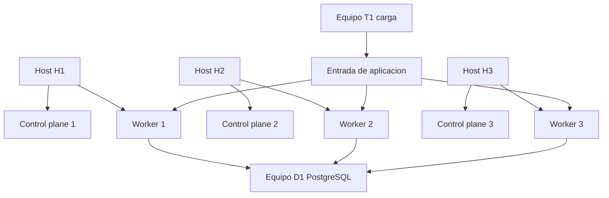

# Diseño del laboratorio Kubernetes OKD y OpenShift

DOC-02-01 · Propuesta de siguiente etapa del seminario · Versión 1.0  
Fecha 13 de octubre de 2026 · Base documental DOC-01-01

Se recomienda iniciar con una laptop de 32 GB de RAM, procesador de ocho hilos lógicos o más y SSD con 100 GB libres, usando kind para estudiar Kubernetes. La ampliación recomendada utiliza cinco equipos para separar clúster, datos y generación de carga. No se necesita adquirir cinco equipos antes de comenzar: primero se comprobará la capacidad del hardware disponible.

Las especificaciones son presupuestos de diseño del seminario, no hardware confirmado ni requisitos oficiales universales. No se ha instalado ni probado el laboratorio. La Fase 00 está aprobada; DOC-01-01 está entregado para revisión. Este documento propone la etapa de diseño previa a la instalación, sin dar por aprobados resultados o decisiones pendientes.

## Índice

1. Objetivo y resultados esperados
2. Escenario inicial con una laptop
3. Escenario ampliado con cinco equipos
4. Alternativa con cuatro equipos
5. Red almacenamiento y seguridad
6. Versiones y secuencia de instalación
7. Validaciones y decisiones pendientes
8. Fuentes y convenciones

## 1 Objetivo y resultados esperados

El laboratorio debe permitir crear y reemplazar Pods, publicar una API, observar consumo, comparar réplicas y comprobar integridad de reservas bajo concurrencia. Más adelante deberá demostrar recuperación ante la pérdida de un host físico, cuando existan dominios de falla separados. El alcance y las invariantes del caso de reservas se conservan de DOC-01-01.

La aceptación distingue aprendizaje y medición. Un clúster local permite entender recursos y detectar defectos, pero una medición realizada junto al generador y a la base en la misma laptop no representa capacidad empresarial. La comparación deberá registrar recursos asignados y separar el incremento de capacidad física del beneficio de distribuir réplicas.

| Entorno | Uso principal | Límite que se debe declarar |
| --- | --- | --- |
| Una laptop con kind | Fundamentos y aplicación mínima | Todo comparte un host físico |
| CRC opcional | Consola y conceptos de plataforma integrada | Un solo nodo y versión de bundle propia |
| Clúster en tres hosts | Distribución y pérdida de un host | Almacenamiento y servicios externos también necesitan continuidad |
| Datos y carga separados | Reducir interferencia al medir | Una base única sigue siendo punto de falla |

kind está orientado a clústeres locales en contenedores; permite configurar múltiples nodos lógicos sin crear dominios físicos independientes. CRC documenta un flujo local y un preset OKD, cuya versión de bundle deberá comprobarse. [L1, L2, L3]

## 2 Escenario inicial con una laptop

### Hardware sugerido

| Componente | Recomendación del seminario | Justificación |
| --- | --- | --- |
| Procesador | Arquitectura x86_64 y al menos ocho hilos lógicos | Margen para sistema anfitrión y contenedores |
| Memoria | 32 GB recomendados; 16 GB para recorrido reducido | Evitar presión al ejecutar aplicación y observabilidad |
| Disco | SSD con 100 GB libres para comenzar | Imágenes, contenedores y evidencia acotada |
| Red | Conexión estable; cableada para mediciones | Reducir variación de latencia |
| Virtualización | Disponible y habilitada cuando el runtime la requiera | Ejecutar el entorno Linux de contenedores |
| Sistema anfitrión | Windows 11 de 64 bits o Linux compatible con herramientas elegidas | Mantener una ruta documentada por plataforma |

Estas cifras son estimaciones propias. No aseguran una tasa de solicitudes concreta. Se recomienda usar primero hardware existente y medir memoria y disco libres antes de seleccionar el runtime.

### Asignación inicial de recursos

En una laptop de 32 GB se propone reservar 8 GB al anfitrión y aplicaciones de escritorio, y limitar inicialmente el entorno de contenedores a 16 GB. Quedan 8 GB de margen sin comprometer. Dentro del entorno de contenedores se presupuestan 4 GB para Kubernetes y servicios base, 4 GB para API y procesador, 4 GB para datos y 4 GB para observabilidad y margen. Los presupuestos no son límites de memoria por Pod ni una medición del consumo real.

Se comenzará con un control plane y un worker lógicos. Un tercer nodo lógico se añadirá si existe margen. En la variante de 16 GB se usará un nodo y observabilidad mínima, con carga ligera. Los ensayos de estrés se detendrán si el host empieza a paginar de forma sostenida, falta espacio o el generador pierde capacidad de sostener su tasa.

CRC y kind se utilizarán de forma alternada al principio. No se presupuesta ejecutar ambos simultáneamente. La demostración inicial comprobará despliegue, lectura, reserva, idempotencia y reemplazo de un Pod. La meta de 600 solicitudes por segundo de DOC-01-01 seguirá siendo una hipótesis que se ajusta después de medir una réplica.

## 3 Escenario ampliado con cinco equipos

### Distribución recomendada

| Equipo | Hardware sugerido | Función propuesta |
| --- | --- | --- |
| H1 | Ocho núcleos físicos o más, 64 GB RAM, SSD de 1 TB | Host de VM control plane 1 y VM worker 1 |
| H2 | Ocho núcleos físicos o más, 64 GB RAM, SSD de 1 TB | Host de VM control plane 2 y VM worker 2 |
| H3 | Ocho núcleos físicos o más, 64 GB RAM, SSD de 1 TB | Host de VM control plane 3 y VM worker 3 |
| D1 | Cuatro núcleos o más, 32 GB RAM, SSD de 500 GB | PostgreSQL externo y datos de prueba |
| T1 | Cuatro núcleos o más, 16 GB RAM, SSD de 256 GB | Generación de carga y administración |

Es preferible usar PCs o servidores disponibles como H1 a H3; no es obligatorio comprar laptops. Si se usan portátiles, deberán permanecer alimentados, sin suspensión automática y con refrigeración suficiente. La conexión recomendada es Ethernet de 1 Gbit/s y un switch común para el laboratorio.

### Presupuesto de máquinas virtuales

| Tipo de VM | Cantidad | CPU virtual por VM | RAM por VM | Disco por VM |
| --- | --- | --- | --- | --- |
| Control plane | 3 | 4 | 16 GB | 120 GB |
| Worker | 3 | 4 | 16 GB | 120 GB |
| Bootstrap temporal si el método lo utiliza | 1 | 4 | 16 GB | 120 GB |

Las seis VMs permanentes suman 24 CPU virtuales, 96 GB de RAM y 720 GB de discos asignados. Cada host ejecuta 8 CPU virtuales, 32 GB de RAM y 240 GB de disco para esas VMs. Se reservan además 8 GB de RAM por host para el anfitrión. Sobre tres hosts de 64 GB, quedan 72 GB agregados sin comprometer después de esas reservas; bootstrap temporal utiliza 16 GB de ese margen cuando corresponda. La memoria física instalada de los cinco equipos suma 240 GB.

El presupuesto de CPU virtual no equivale a núcleos físicos de rendimiento garantizado. Se evitará sobreasignación agresiva durante ensayos. Los SSD de 1 TB dejan espacio para anfitrión, imágenes y evidencia; los 720 GB son discos virtuales asignados y no una capacidad útil de almacenamiento distribuido.

Como referencia de producto, OpenShift 4.22 documenta mínimos por máquina de 4 CPU, 16 GB de RAM y 100 GB de disco para control plane, y 2 CPU, 8 GB y 100 GB para compute. El diseño aumenta compute y disco para las cargas del seminario. La referencia OpenShift no certifica estos hosts ni reemplaza los requisitos específicos del payload OKD que se seleccione. [L4]

### Dominios de falla

Figura 1. Distribución física propuesta. La entrada y la base necesitan sus propias decisiones de continuidad.

Perder un host retira un control plane y un worker simultáneamente. El ensayo requiere que los dos control planes restantes mantengan quorum y que los workers restantes tengan capacidad. Se conservarán al menos dos réplicas de API distribuidas y se verificará la recolocación. La base externa D1 y una entrada única siguen siendo puntos de falla: esta topología no acredita alta disponibilidad completa del sistema.

Para probar pérdida de un host de clúster, T1 puede alojar una entrada de laboratorio que permanezca activa durante esa falla; su consumo se registrará por compartir equipo con el generador. Para eliminar esa interferencia o demostrar continuidad de la entrada se añadirá infraestructura dedicada o un balanceador redundante. La pérdida del switch o de alimentación común afecta a todo el laboratorio.

## 4 Alternativa con cuatro equipos

Se mantienen H1, H2 y H3 con las mismas VMs y se usa un cuarto equipo de 32 GB para PostgreSQL y generación de carga. La administración puede hacerse desde ese equipo. Es una alternativa de ahorro para probar distribución física, pero base y generador competirán por CPU, disco y memoria.

Se propone presupuestar 8 GB para anfitrión, 12 GB para datos, 4 GB para generación y 8 GB de margen. Se registrará el consumo del generador y se declarará inválida una conclusión sobre capacidad del servidor si el cliente no sostiene la tasa objetivo. Una medición de cuatro equipos no será directamente comparable con la de cinco sin declarar esa diferencia.

Si solo hay tres equipos disponibles, la prioridad será repartir los control planes en tres hosts y realizar carga limitada desde un equipo disponible sin afirmar aislamiento del generador. Con dos equipos se mantendrá el clúster local en uno y carga en otro. El número de dispositivos no permite inferir que haya memoria suficiente para OKD.

## 5 Red almacenamiento y seguridad

### Plan de red propuesto

| Elemento | Propuesta inicial | Verificación antes de instalar |
| --- | --- | --- |
| Red de laboratorio | Subred privada dedicada sin solapamientos | Comparar LAN, VPN, Pods y Services |
| Direcciones | Reservas estables para hosts y VMs | Comprobar resolución y conectividad |
| DNS | Resolver nombres de API y aplicaciones | Consultar desde todos los equipos |
| Hora | Fuente de tiempo coherente | Registrar desfase y corregirlo |
| Entrada | TLS para el camino medido | Certificado y nombre válidos |
| Administración | Acceso restringido desde equipo autorizado | Evitar publicación innecesaria |

No se asigna un rango IP definitivo sin revisar la red existente. La documentación de instalación elegida determinará registros DNS, balanceo y puertos exactos. Para OKD se verificará el sistema operativo del payload y no se mezclarán activos FCOS históricos con SCOS actual. [L4, L5]

### Archivos y datos persistentes

La raíz de código y documentación es `C:\Users\walte\OneDrive\Documentos\Desarrollo\Kubernets\Redhat openshift`. Allí se guardarán fuentes, manifiestos, manuales y resultados resumidos. Discos de VMs, volúmenes activos de bases, credenciales y kubeconfig no deben formar parte del repositorio. Se elegirá una ubicación local dedicada para datos de ejecución antes de instalar, evitando depender de sincronización de archivos para almacenar una base activa.

Los respaldos del caso se conservarán fuera del disco que protegen y se ensayará su restauración. Los logs exportados se revisarán para excluir tokens, contraseñas y datos personales. La entrada externa expondrá solo la API necesaria; PostgreSQL permanecerá en la red de laboratorio.

Se propone acceso por funciones de administrador, desarrollador y lector. La aplicación no usará privilegios de administrador de clúster. Las políticas de ejecución se comprobarán antes de habilitar carga, para evitar que una diferencia de permisos se confunda con una falla de capacidad.

## 6 Versiones y secuencia de instalación

### Ficha de versiones

| Componente | Referencia investigada | Decisión de instalación |
| --- | --- | --- |
| kind | Guía actual consulta v0.33.0 | Fijar versión y digest de imagen de nodo compatible |
| Kubernetes upstream | DOC-01-01 registra serie 1.37 | Usar versión soportada por la imagen kind elegida |
| OKD | Notas 5.0.0-okd-scos.0 | Confirmar payload, instalador y arquitectura como conjunto |
| OpenShift | DOC-01-01 investiga 4.22 | Solo evaluar con acceso y soporte aplicables |
| CRC | Flujo local oficial | Confirmar bundle disponible; no asumir equivalencia con OKD actual |
| Runtime y virtualización | Aún no elegidos | Seleccionar según sistema anfitrión real |

Las referencias documentales no son una lista de versiones ya instaladas. No se sustituirá la versión Kubernetes incorporada en OKD u OpenShift por la última upstream. [L1, L3, L5]

### Orden propuesto

1. Obtener inventario real o seleccionar una máquina disponible para comenzar.
2. Revisar espacio, virtualización, conectividad y restricciones del anfitrión.
3. Fijar herramientas, versiones y ubicación local de datos de ejecución.
4. Preparar el manual de instalación de esa ruta.
5. Instalar el runtime y kind y validar un clúster mínimo.
6. Desplegar la aplicación de reservas e instrumentación mínima.
7. Medir una réplica antes de configurar escalamiento.
8. Ampliar a OKD y multinodo físico si el hardware lo permite.
9. Ejecutar carga, integridad y resiliencia conservando evidencia.

Este documento prepara la decisión y no ejecuta instalaciones ni cambios de configuración del equipo. La secuencia evita que las pruebas de estrés comiencen sobre un ambiente sin salud o sin datos reproducibles.

## 7 Validaciones y decisiones pendientes

| Puerta | Evidencia necesaria | Estado actual |
| --- | --- | --- |
| Hardware | CPU, RAM, SSD libre y sistema por equipo | Pendiente de inventario real |
| Ruta inicial | Laptop disponible que permita el presupuesto | Recomendada con kind |
| Red | Rangos, DNS, hora y camino de entrada | Pendiente de comprobación |
| Versiones | Lista fijada y activos verificables | Referencias investigadas |
| Aplicación | Contratos e invariantes implementados | Diseño en DOC-01-01 |
| Pruebas | Resultados originales y métricas | No ejecutadas |

La recomendación concreta es comenzar con una laptop de 32 GB y reservar el diseño de cinco equipos para la demostración de distribución física. Si la laptop disponible tiene 16 GB, se hará primero el recorrido reducido. No se recomienda comprar hardware antes de comparar estas especificaciones con el inventario existente.

El siguiente entregable será un manual de instalación para la ruta seleccionada. Si el anfitrión aún no se confirma, podrá prepararse una guía con variantes Windows y Linux, indicando los pasos que dependen de cada sistema. La cifra objetivo de carga se ajustará después de medir; la ausencia de sobreventa e idempotencia sí será un requisito obligatorio desde el primer escenario.

## 8 Fuentes y convenciones

Fuentes oficiales consultadas el 13 de octubre de 2026. DOC-01-01 conserva la investigación integral y su bibliografía.

- [L1] kind. Quick Start. https://kind.sigs.k8s.io/docs/user/quick-start/
- [L2] kind. Configuration. https://kind.sigs.k8s.io/docs/user/configuration/
- [L3] CRC. Get started. https://crc.dev/docs/getting-started/
- [L4] Red Hat. OpenShift Container Platform 4.22 Installing on bare metal, User-provisioned infrastructure. https://docs.redhat.com/en/documentation/openshift_container_platform/4.22/html/installing_on_bare_metal/user-provisioned-infrastructure
- [L5] OKD. OKD 5.0 Release Notes. https://okd.io/blog/2026/09/17/okd-5.0-release-notes/

Formato Word: Times New Roman 12 pt, texto negro, tablas con encabezado de fondo negro y letra blanca, estilos de encabezado e índice actualizable. El diagrama Mermaid editable se conserva en esta fuente y en `diagramas/laboratorio-cinco-equipos.mmd`.
