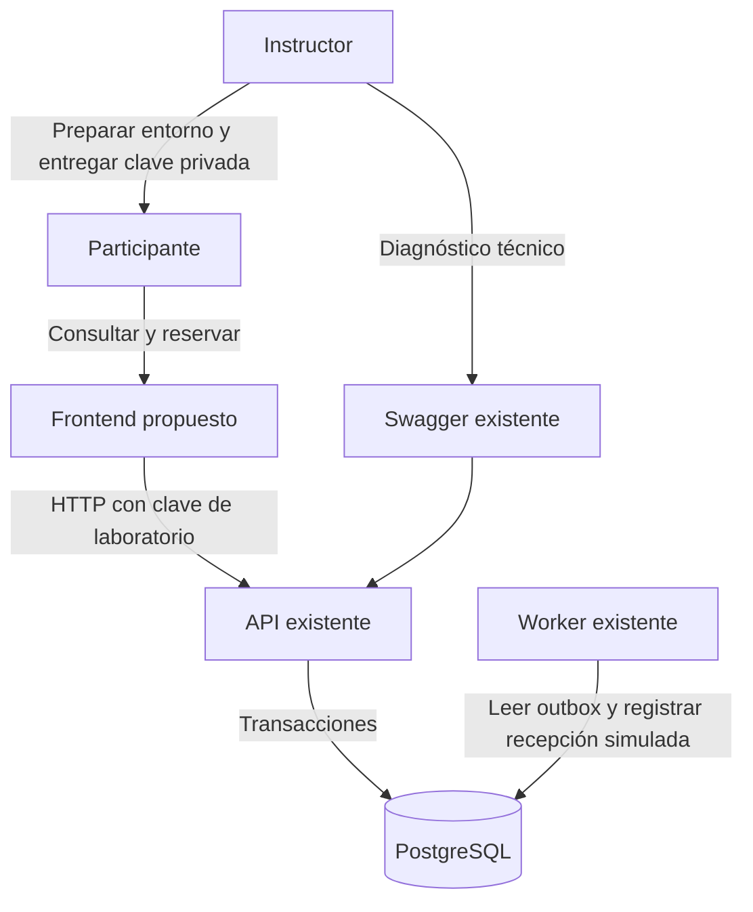

# Análisis de requisitos del frontend de reservas

Documento DOC-10-01. Etapa 01. Versión 1.0. Fecha 17 de octubre de 2026.

## Propósito y conclusión

La API existente necesita una interfaz para que participantes del seminario consulten cupos, creen una reserva y recuperen su confirmación sin construir peticiones HTTP manualmente. Se propone un frontend de laboratorio que reutilice los contratos actuales y conserve la protección contra operaciones duplicadas. Este documento especifica requisitos; no acredita implementación ni aceptación.

## Situación actual

FastAPI autentica mediante `X-Api-Key`. PostgreSQL almacena eventos, reservas y outbox. La creación confirma reserva, descuento de cupos y evento en una transacción. Un worker procesa el receptor simulado. Swagger permite probar la API, pero no constituye una interfaz de negocio.

El catálogo requiere autenticación y devuelve id, name, capacity y available. El endpoint de disponibilidad devuelve id, capacity y available. La API admite cantidades enteras entre 1 y 100 por solicitud. La consulta individual solo devuelve reservas del cliente autenticado. No existe endpoint de inicio de sesión, cierre de sesión, listado de reservas o estado del worker para el usuario.

## Objetivos y alcance

O1: completar una reserva desde el navegador y mostrar un comprobante identificable. O2: explicar cupos y concurrencia sin prometer que la disponibilidad observada esté garantizada. O3: conservar la identidad de una operación cuando se pierde su respuesta. O4: preparar el frontend como componente independiente del laboratorio.

Incluye acceso con clave de laboratorio, catálogo, disponibilidad, creación, confirmación, consulta por identificador y salida local. Excluye pagos, selección de asientos, cancelaciones, administración, usuarios públicos, OIDC, correos reales e historial completo. No se modifica el esquema SQL para la primera entrega.

## Actores y contexto

A1 Participante: utiliza su clave de laboratorio para reservar y consultar. A2 Instructor: prepara el entorno, distribuye credenciales por un canal privado y dirige la demostración; no recibe un rol administrativo nuevo. S1 API: sistema externo al límite del frontend que autoriza y ejecuta operaciones. PostgreSQL y worker son componentes del backend, no actores que interactúen directamente con las pantallas.

Figura D10-01: contexto del sistema. Fuente `diagramas/fase-10/D10-01-contexto.mmd`. El límite separa la interacción del navegador de la persistencia y del proceso asíncrono. El acceso del instructor a Swagger es una herramienta técnica existente; no una función del frontend propuesto.

## Requisitos funcionales

| ID | Requisito | Prioridad |
| --- | --- | --- |
| RF01 | Ingresar una clave enmascarada y validarla consultando el catálogo | Esencial |
| RF02 | Listar eventos y distinguir catálogo vacío de error de conexión | Esencial |
| RF03 | Consultar y actualizar cupos de un evento antes de reservar | Esencial |
| RF04 | Validar cantidad entera de 1 a 100 y solicitar confirmación explícita | Esencial |
| RF05 | Crear una operación con clave idempotente y bloquear doble envío visual | Esencial |
| RF06 | Mostrar la misma confirmación para respuestas 201 y 200 repetida | Esencial |
| RF07 | Recuperar una operación incierta con la misma clave y el mismo contenido | Esencial |
| RF08 | Consultar una reserva por UUID y mostrar solo el resultado autorizado | Esencial |
| RF09 | Explicar errores de autenticación, validación, cupo y disponibilidad técnica | Esencial |
| RF10 | Salir borrando credencial y datos locales de la sesión | Esencial |
| RF11 | Copiar el identificador y actualizar cupos tras confirmar | Deseable |

## Requisitos de calidad

| ID | Criterio propuesto | Verificación prevista |
| --- | --- | --- |
| RN01 | Español, etiquetas visibles y recorrido por teclado | Revisión manual de todas las pantallas |
| RN02 | Uso a 360 y 1280 píxeles de ancho sin desplazamiento horizontal del contenido | Inspección visual en navegador |
| RN03 | No incluir claves en repositorio, bundle, URL ni registros | Inspección de artefactos y red |
| RN04 | No almacenar la clave API de forma persistente | Revisar storage y recargar la página |
| RN05 | Contenedor sin privilegios, puerto 8080 y archivos estáticos de solo lectura cuando sea viable | Ensayo con UID arbitrario |
| RN06 | Mensajes de error accesibles, foco controlado y estados anunciados | Teclado y lector de pantalla |
| RN07 | Timeout de cliente inicialmente 15 segundos, configurable y sin reintento automático del POST | Simular latencia y pérdida de respuesta |
| RN08 | Límites de CPU, memoria y capacidad se fijarán tras medir el frontend y el entorno | Medición posterior, sin objetivo acreditado |

Los valores de anchura y timeout son decisiones iniciales de diseño, no mediciones de rendimiento ni certificación de accesibilidad.

## Reglas de negocio

RB01: el servidor decide si hay cupo; una lectura previa puede quedar desactualizada. RB02: una reserva exitosa queda confirmed. RB03: una clave de operación pertenece al cliente autenticado y se vincula a evento y cantidad. RB04: repetir esos datos y clave devuelve la reserva original; cambiar contenido devuelve 409 idempotency_conflict. RB05: no se muestra como reservada una operación sin respuesta confirmada del servidor. RB06: 404 de una reserva no distingue públicamente entre inexistente y ajena. RB07: confirmar reserva no significa que se haya enviado una notificación externa.

## Supuestos y dependencias

El instructor proporciona una clave válida sin incorporarla al frontend. Se utiliza un mismo origen para página y API. El navegador admite almacenamiento de sesión y generación de UUID; habrá una alternativa explícita si el almacenamiento está bloqueado. Las decisiones de framework y servidor aún son propuestas. La imagen, sus versiones y los recursos del clúster se fijarán durante implementación.

## Criterio de salida de la etapa

Requisitos identificados, límites explícitos y asociación con casos de uso. La revisión del usuario puede cambiar prioridades. Esta etapa no autoriza afirmar resultados funcionales del frontend.

## Diagramas editables

### D10-01

