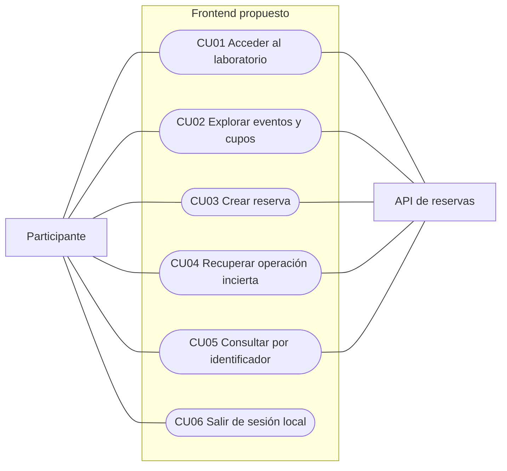

# Casos de uso del frontend de reservas

Documento DOC-10-02. Etapa 02. Versión 1.0. Fecha 17 de octubre de 2026.

## Propósito y lectura del diagrama

Se detallan acciones observables del participante y respuestas esperadas. Todos los casos están propuestos y pendientes de ejecución. Figura D10-02: mapa de casos de uso, fuente `diagramas/fase-10/D10-02-casos-uso.mmd`. Se usa un flowchart Mermaid con casos en óvalos; es una representación funcional, no una afirmación de conformidad con toda la notación UML. Las conexiones significan participación o dependencia funcional, no orden temporal.

## CU01 Acceder al laboratorio

Actor: participante. Requisitos: RF01, RF09. Disparador: abrir la aplicación o recibir 401. Precondición: disponer de una clave entregada por el instructor; no se presume que la API esté disponible.

Flujo principal: 1. Mostrar campo enmascarado y aviso de uso de laboratorio. 2. El participante ingresa la clave. 3. El frontend conserva temporalmente la clave en memoria y consulta GET /catalogo. 4. Con 200 muestra el catálogo y activa la sesión local.

Alternativas: clave vacía impide envío; 401 borra la clave y muestra credenciales inválidas; error de red o 503 conserva la pantalla con opción de reintentar, sin afirmar que la credencial es incorrecta. Una respuesta 200 con events vacío permite acceso y muestra catálogo vacío.

Postcondición: credencial en memoria y catálogo visible, o acceso no confirmado. Aceptación AC01: una clave válida abre el catálogo; una inválida no lo abre ni aparece en URL o storage persistente.

## CU02 Explorar eventos y disponibilidad

Actor: participante. Requisitos: RF02, RF03. Precondición: sesión local activa. Disparador: abrir catálogo, seleccionar evento o pulsar Actualizar cupos.

Flujo principal: 1. Leer GET /catalogo. 2. Mostrar nombre, capacidad y cupos observados. 3. Seleccionar evento. 4. Consultar GET /eventos/{id}/disponibilidad. 5. Mostrar momento local de consulta y acción de reservar si hay cupos.

Alternativas: catálogo vacío ofrece actualizar; 404 indica evento no disponible y permite volver; error de conexión conserva los datos previos marcados como desactualizados; cero cupos deshabilita nuevas reservas desde esa vista. La lectura no bloquea ni garantiza inventario.

Postcondición: información visible, sin cambio en el servidor. AC02: el participante distingue datos actuales, vacíos, agotados y desactualizados.

## CU03 Crear una reserva

Actor: participante. Requisitos: RF04, RF05, RF06, RF09, RF11. Precondición: sesión activa, evento seleccionado, sin otra operación pendiente. Disparador: confirmar evento y cantidad.

Flujo principal: 1. Validar entero de 1 a 100 y disponibilidad observada. 2. Mostrar resumen. 3. Al confirmar, generar una clave aleatoria para esta intención y congelar event_id y quantity. 4. Guardar el registro de operación en sessionStorage antes de enviar, sin credencial. 5. Enviar POST /reservas con X-Api-Key e Idempotency-Key. 6. Con 201 mostrar comprobante. 7. Retirar el registro pendiente, ofrecer copiar UUID y refrescar cupos.

Alternativas: 200 muestra la misma confirmación con indicación de recuperación; 409 sold_out informa cupos insuficientes y refresca disponibilidad; 409 idempotency_conflict bloquea reintento y requiere revisión del registro local; 404 informa evento no disponible; 422 señala validación; 401 requiere reingreso de la misma identidad; timeout, desconexión, respuesta no interpretable o error 5xx conservan la operación como incierta. Un error al refrescar cupos no invalida la reserva confirmada. Si no se puede guardar el registro, no enviar y explicar que debe habilitarse el almacenamiento de sesión.

Postcondición: una reserva confirmada con UUID, rechazo conocido o resultado incierto pendiente de recuperar. AC03: doble clic no genera dos intenciones; el cliente no interpreta timeout como rechazo ni habilita una nueva reserva mientras la anterior sea incierta.

## CU04 Recuperar una operación incierta

Actor: participante. Requisitos: RF07, RF09. Precondición: registro pendiente con clave, event_id, quantity y cliente esperado. Disparador: pulsar Recuperar resultado o recargar con un registro pendiente.

Flujo principal: 1. Mostrar evento y cantidad congelados. 2. Solicitar la misma clave API si se perdió la memoria de la página. 3. Comprobar que la credencial corresponde a la huella local de la operación. 4. Con confirmación explícita del participante, reenviar exactamente la solicitud original. 5. Un 200 recupera la reserva; un 201 indica que este envío la creó. 6. Mostrar confirmación y retirar el pendiente.

Alternativas: otra credencial se rechaza antes del POST para evitar una reserva bajo otro cliente; 409 sold_out es rechazo conocido del envío actual y permite actualizar cupos; nuevo error técnico mantiene el pendiente; idempotency_conflict bloquea el flujo para revisión técnica. No hay búsqueda por clave idempotente en la API, por lo que la recuperación utiliza el mismo POST. Una credencial rotada requiere intervención del instructor: la huella del token no identifica permanentemente al cliente.

Postcondición: resultado confirmado o pendiente conservado. AC04: simular respuesta perdida tras commit y verificar que recuperar devuelve el mismo UUID y un único descuento. Cerrar la pestaña puede perder el registro; esa limitación se comunica antes de abandonar.

## CU05 Consultar una reserva

Actor: participante. Requisitos: RF08, RF09. Precondición: sesión activa y UUID conocido. Disparador: introducir identificador y consultar.

Flujo principal: validar formato UUID, ejecutar GET /reservas/{id} y mostrar id, event_id, quantity, status y created_at. Resolver el nombre con el catálogo cuando esté disponible; conservar el identificador si no lo está.

Alternativas: formato inválido no envía; 404 informa Reserva no disponible para estas credenciales; 401 vuelve al acceso; fallo técnico permite reintentar. No se muestra listado ni se deduce propiedad a partir del UUID.

Postcondición: datos autorizados visibles sin modificación. AC05: una reserva de otro cliente no expone sus datos y usa el mismo mensaje que una inexistente.

## CU06 Salir de la sesión local

Actor: participante. Requisitos: RF10. Precondición: credencial en memoria o datos de sesión. Disparador: pulsar Salir.

Flujo principal: advertir si hay una operación incierta; con confirmación explícita, borrar credencial, respuestas, huella y pendiente de sessionStorage, y volver al acceso. Sin pendiente, la salida es inmediata.

Alternativas: cancelar la salida mantiene el estado. Salir no cancela reservas ni revoca la clave del servidor. Una operación ya recibida puede confirmarse incluso si la página se cierra.

Postcondición: no quedan datos de esta aplicación en la sesión local. AC06: verificar limpieza y advertencia antes de descartar un pendiente.

## Límites comunes

El instructor distribuye credenciales y prepara el entorno mediante procedimientos técnicos existentes, fuera de estos casos. La recepción simulada no forma parte de la confirmación visible. La API continúa siendo responsable de autorización, integridad e inventario.

## Diagramas editables

### D10-02

