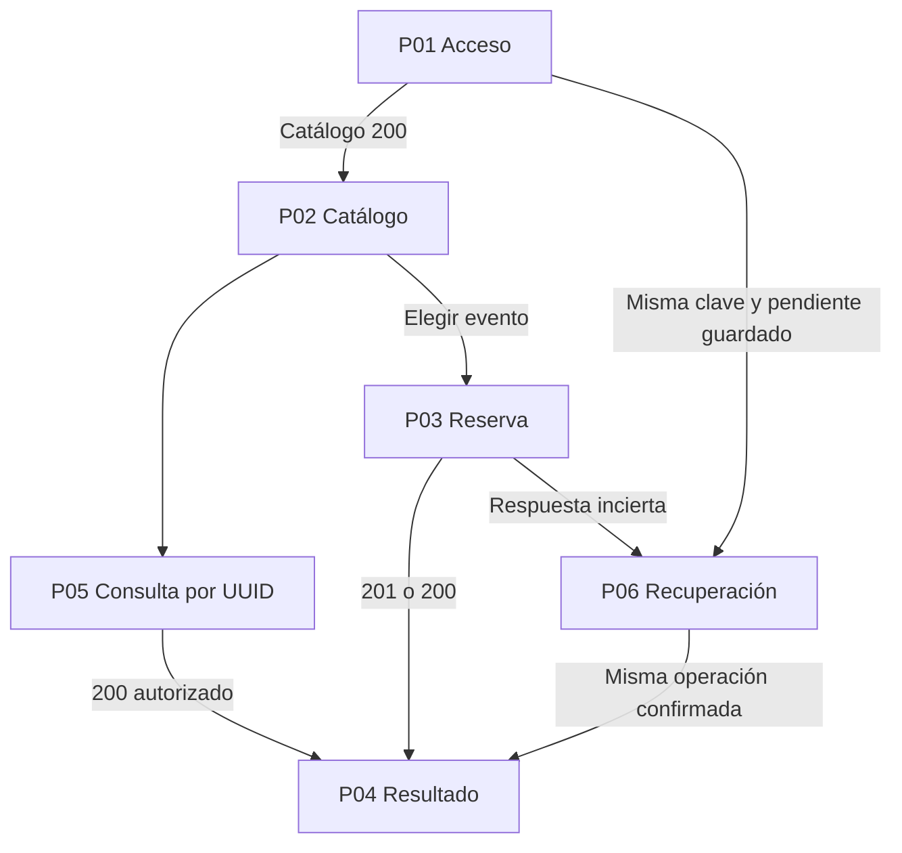
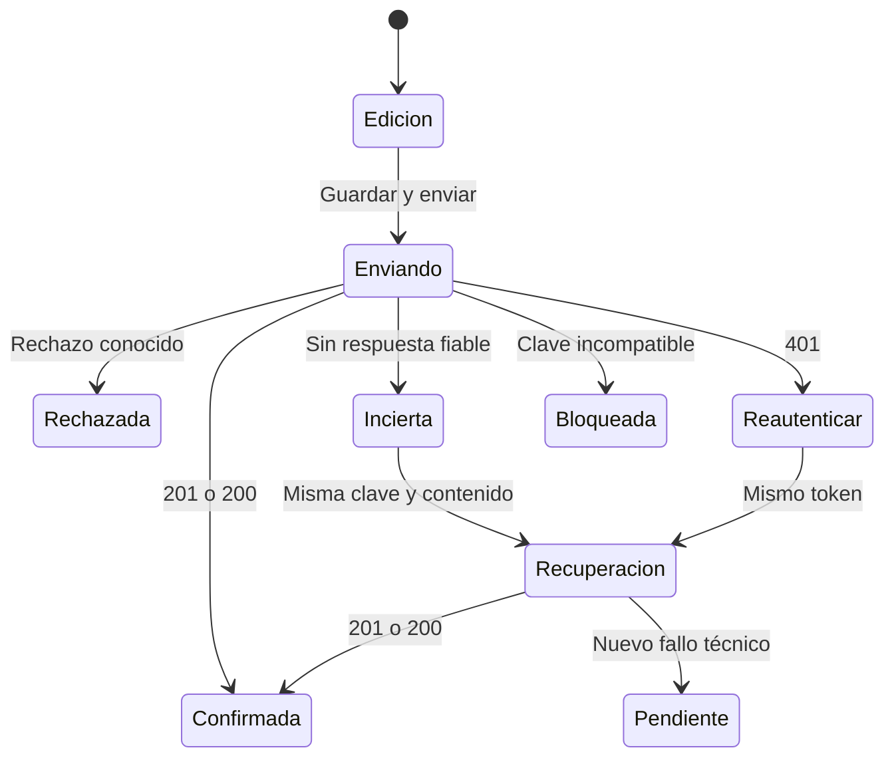
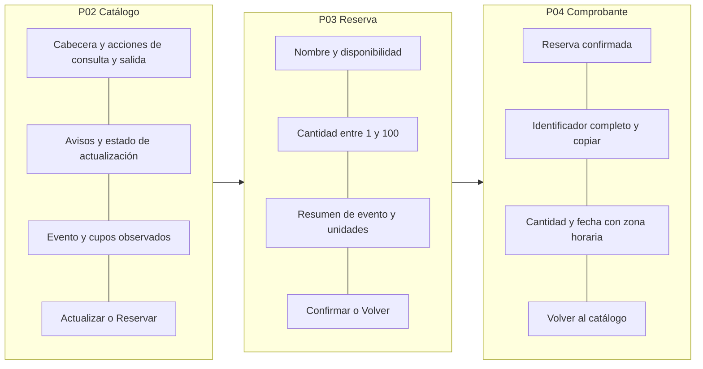

# Diseño de experiencia del frontend de reservas

Documento DOC-10-03. Etapa 03. Versión 1.0. Fecha 17 de octubre de 2026.

## Principios de interacción

La interfaz prioriza un recorrido breve: acceder, elegir evento, confirmar cantidad y guardar el identificador. Diferencia reserva confirmada, rechazo conocido y resultado incierto. La disponibilidad es informativa y se actualiza mediante consultas; no se presenta como tiempo real ni se simulan datos cuando el backend falla.

Figura D10-03: navegación, fuente `diagramas/fase-10/D10-03-navegacion.mmd`. Muestra pantallas y salidas alternativas. Figura D10-04: estados de operación, fuente `diagramas/fase-10/D10-04-estados.mmd`. El estado incierto bloquea una nueva intención hasta recuperar el resultado o descartar expresamente el contexto mediante la salida advertida.

## Pantallas propuestas

| ID | Pantalla | Controles y contenido |
| --- | --- | --- |
| P01 | Acceso | Título, aviso de laboratorio, clave enmascarada, Entrar, error contextual |
| P02 | Catálogo | Nombre de evento, capacidad, cupos, Actualizar, Reservar, Consultar reserva y Salir |
| P03 | Reserva | Evento, disponibilidad observada, cantidad, resumen, Confirmar y Volver |
| P04 | Resultado | Estado, UUID copiable, cantidad, fecha y Volver al catálogo |
| P05 | Consulta | Campo UUID, Consultar, resultado autorizado y error genérico de no disponibilidad |
| P06 | Recuperación | Operación congelada, aviso de resultado incierto y Recuperar resultado |

La clave no se precarga desde archivos locales ni variables públicas. P04 también representa la consulta exitosa, sin sugerir que se acaba de crear una reserva cuando procede de CU05.

## Bocetos funcionales

Figura D10-05: distribución de pantalla, fuente `diagramas/fase-10/D10-05-pantallas.mmd`. Representa agrupación y orden de lectura, no un diseño gráfico implementado.

En P02, la cabecera contiene Reservas del seminario, Consulta y Salir. El cuerpo presenta una tarjeta por evento con nombre, cupos y botón Reservar. Los avisos se sitúan antes del listado. En móvil, acciones y tarjetas se ordenan en una columna.

En P03, el nombre y los cupos se muestran antes de Cantidad. El resumen explicita evento y unidades; Confirmar reserva permanece deshabilitado durante el envío. El participante puede volver antes del envío sin alterar datos del servidor.

En P04, Reserva confirmada precede al identificador, cantidad y fecha local con zona horaria. Una recuperación exitosa incluye La operación ya estaba registrada cuando la API devuelve 200. El UUID completo permanece seleccionable y dispone de alternativa manual si copiar al portapapeles falla.

## Estados visuales y mensajes

| Situación | Mensaje propuesto | Acción |
| --- | --- | --- |
| Espera de catálogo | Cargando eventos | Mantener estructura, impedir acciones dependientes |
| Catálogo vacío | No hay eventos disponibles | Actualizar |
| Datos previos con fallo de actualización | No pudimos actualizar los cupos | Marcar datos previos y reintentar |
| 401 | La clave no es válida o ya no está habilitada | Reingresar credencial |
| 409 sold_out | No quedan cupos suficientes para esta cantidad | Actualizar y revisar cantidad |
| 409 idempotency_conflict | La operación guardada no coincide con la solicitud | Bloquear reenvío y pedir revisión al instructor |
| Timeout o fallo técnico durante POST | No podemos confirmar el resultado todavía | Recuperar con la misma operación |
| 404 de consulta | Reserva no disponible para estas credenciales | Revisar UUID o credencial |
| Confirmación válida y cupos sin actualizar | Reserva confirmada; cupos pendientes de actualización | Conservar comprobante y reintentar lectura |

No se muestra una traza, SQL ni la clave. Los mensajes de la API se traducen mediante códigos conocidos; un código desconocido se trata de forma conservadora. Los errores con detail de FastAPI y error del dominio se normalizan en un adaptador.

## Accesibilidad y comportamiento adaptable

Cada campo tendrá label persistente, instrucciones y error asociado. La cantidad usará entrada numérica con validación estricta; no bastan min y max del navegador. Los avisos se comunicarán mediante regiones de estado. Tras cambiar de pantalla, el foco irá al título; un error de formulario moverá el foco al primer campo inválido. No se dependerá solo de color ni habrá interacción exclusiva de ratón.

Se propone contraste de texto normal de al menos 4.5 a 1 como criterio de diseño, sujeto a comprobación. Las pruebas se harán con teclado, zoom de 200 por ciento y anchos de 360 y 1280 píxeles. No se declara cumplimiento certificado de una norma de accesibilidad.

## Actualización y concurrencia

Actualizar cupos es una lectura explícita y también ocurre tras una confirmación. No se requiere polling en la primera entrega. Si la API devuelve menos cupos que la cantidad seleccionada, el formulario avisa y exige revisar antes de confirmar. Aunque la lectura indique cupo suficiente, el POST puede devolver sold_out por concurrencia.

## Criterio de salida de la etapa

Pantallas, transiciones, textos y estados definidos para construir el prototipo. Los bocetos requieren revisión visual del usuario antes de considerarlos diseño gráfico aprobado.

## Diagramas editables

### D10-03

### D10-04

### D10-05

