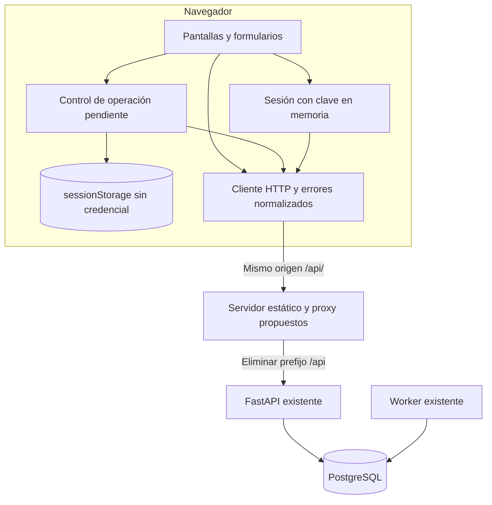
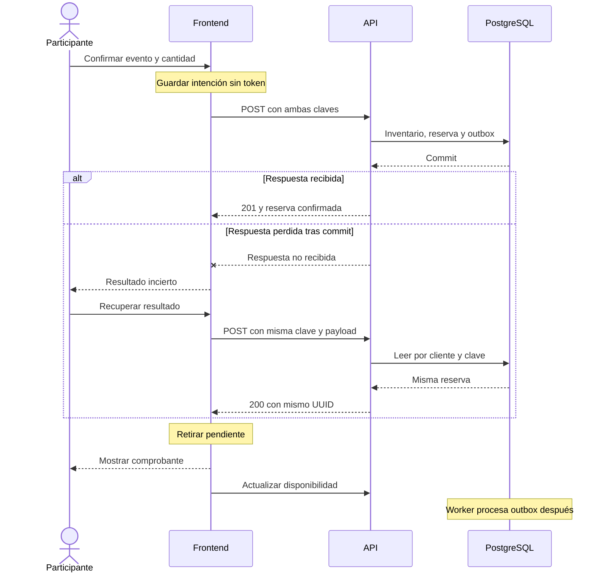
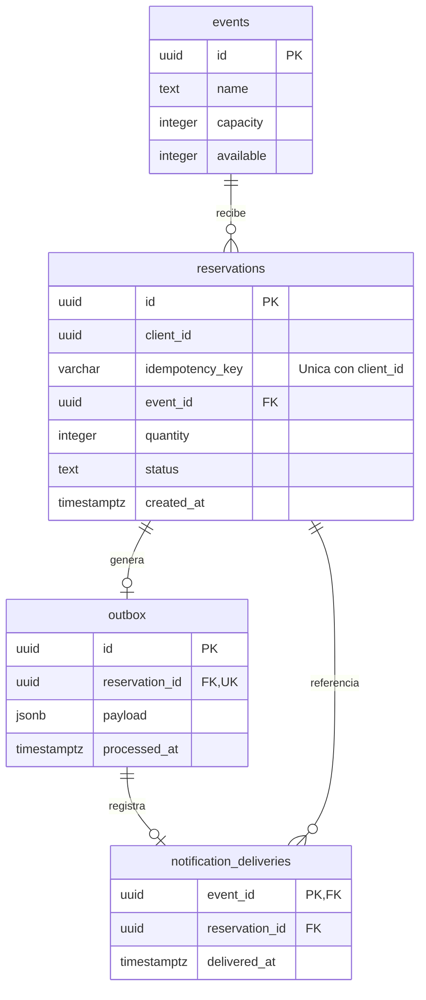
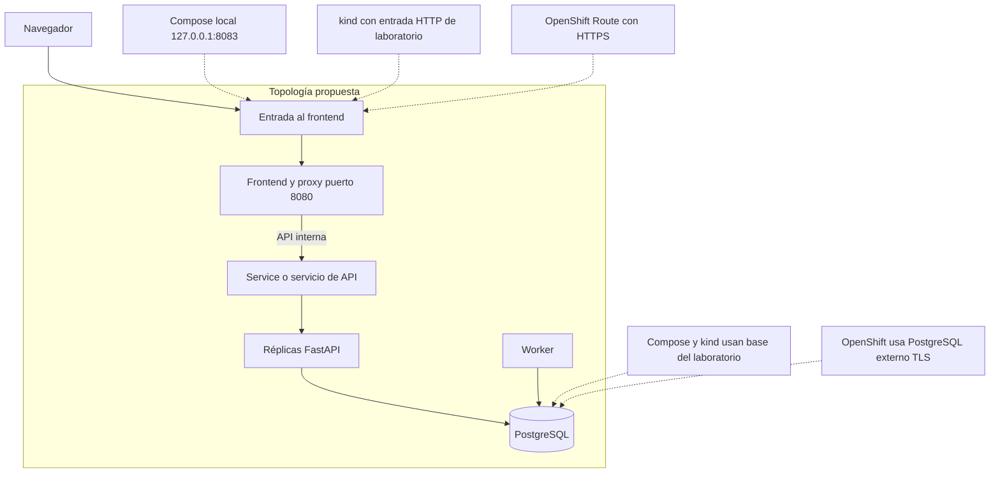

# Diseño técnico del frontend de reservas

Documento DOC-10-04. Etapa 04. Versión 1.0. Fecha 17 de octubre de 2026.

## Arquitectura propuesta

React con TypeScript y Vite construirá una aplicación estática. Un servidor web basado en Nginx compatible con UID arbitrario servirá archivos y reenviará `/api/` a FastAPI, eliminando ese prefijo. La configuración exacta e imágenes se seleccionarán y fijarán durante implementación. Esta propuesta no modifica todavía el backend.

Figura D10-06: componentes, fuente `diagramas/fase-10/D10-06-componentes.mmd`. Las pantallas dependen de un cliente HTTP y de un controlador de operación pendiente; solo el proxy comunica con la API. Figura D10-07: secuencia de reserva y recuperación, fuente `diagramas/fase-10/D10-07-secuencia-reserva.mmd`. La transacción termina antes de la confirmación HTTP; por eso una respuesta perdida no permite concluir que la reserva falló.

## Módulos y responsabilidades

| Módulo | Responsabilidad |
| --- | --- |
| App y navegación | Acceso, catálogo, reserva, consulta y recuperación; rutas con retorno controlado |
| SessionContext | Clave solo en memoria, salida y estado de autenticación |
| apiClient | Headers, prefijo /api, timeout, análisis y normalización de errores |
| reservationOperation | Generación de clave, congelación de payload, exclusión de nueva intención y recuperación |
| pendingStorage | Versión de registro, lectura validada, escritura previa al POST y borrado explícito |
| Pantallas y componentes | Presentación, formularios, foco, mensajes y comprobante |

Los nombres son una guía de construcción, no archivos ya creados. No se incorpora una biblioteca global de estado sin necesidad demostrada. Tipos TypeScript no reemplazan validación de respuestas recibidas.

## Contratos con la API

| Ruta del navegador | Ruta actual del backend | Método y resultado |
| --- | --- | --- |
| /api/catalogo | /catalogo | GET 200 con events |
| /api/eventos/{id}/disponibilidad | /eventos/{id}/disponibilidad | GET 200 con id, capacity y available |
| /api/reservas | /reservas | POST 201 nueva o 200 repetida |
| /api/reservas/{id} | /reservas/{id} | GET 200 con reserva autorizada |

Todas estas rutas necesitan X-Api-Key. POST requiere Idempotency-Key y JSON con event_id UUID y quantity entero de 1 a 100. La reserva devuelve id, event_id, quantity, status y created_at; no devuelve nombre del evento ni estado de notificación. Los UUID se conservan como cadenas y las fechas se presentan con zona horaria.

Errores de dominio usan `{error: codigo}`. HTTPException y validación usan detail. Se contemplan invalid_credentials, event_not_found, reservation_not_found, sold_out, idempotency_conflict, retry_later y database_unavailable. El adaptador manejará también HTML, cuerpo vacío y respuestas inesperadas del proxy. Un 503 puede anunciar Retry-After; el frontend lo usa como orientación para habilitar recuperación manual, sin reintento automático del POST.

## Persistencia local e identidad de operación

La clave API existe únicamente en memoria y desaparece al recargar. sessionStorage guardará un registro con version, operationKey, eventId, quantity, credentialFingerprint, startedAt y estado incierto o enviando. No se guardan claves ni respuestas completas. La huella se calcula con SHA-256 de una clave aleatoria de laboratorio suficientemente larga; no se presenta como autenticación ni como anonimización. Solo impide recuperar accidentalmente con otro token. La autorización real sigue en la API.

Antes del primer POST se escribe y valida el registro. Tras recargar, se requiere reingresar el mismo token y pulsar Recuperar resultado. Si otra clave corresponde al mismo cliente por rotación, la huella no lo sabe: se remite al instructor. Un registro corrupto no se reenvía; se muestra advertencia. Si se pierde el registro al cerrar la pestaña, el frontend no puede reconstruirlo con la API actual. Compartir o duplicar pestañas no crea coordinación global; no se recomienda operar una misma intención desde varias pestañas.

El timeout de cliente aborta la espera, no garantiza cancelación de la transacción. Se conserva clave y payload ante errores inciertos y nunca se genera otra clave para intentar recuperar. Solo tras confirmación o rechazo conocido puede iniciarse una intención nueva. La salida advertida borra el contexto y explica el riesgo de perder recuperación, sin afirmar cancelación.

## Modelo de datos

Figura D10-08: modelo relacional existente, fuente `diagramas/fase-10/D10-08-datos.mmd`. events contiene inventario; reservations vincula cliente, evento y clave; outbox contiene un evento por reserva; notification_deliveries deduplica la recepción simulada por evento. No existe tabla de usuarios. Las claves API se resuelven mediante configuración del backend. No se agregan tablas para el frontend.

La unicidad `(client_id, idempotency_key)` y el descuento condicionado por available pertenecen al servidor. Las validaciones del navegador mejoran la experiencia y no sustituyen controles transaccionales ni de propiedad.

## Seguridad y configuración

No se empaqueta ningún secreto como variable VITE ni se utiliza un proxy que inyecte una identidad compartida. El navegador envía la credencial del participante en un header. El proxy no registrará ese header ni cuerpos de reserva. No se almacenarán tokens en URL, localStorage, sessionStorage o archivos estáticos. El acceso a la base permanece exclusivo del backend.

Las respuestas y nombres se renderizarán como texto sin HTML arbitrario. Se propondrán cabeceras contra ejecución de contenido inesperado y una política de contenido compatible con los recursos locales. El frontend depende de la seguridad del navegador; una huella no protege contra scripts maliciosos. En clúster se requiere HTTPS mediante Ingress o Route; localhost HTTP se reserva para laboratorio. No se afirma que la configuración actual de producción esté completa.

El proxy debe distinguir rutas de API de rutas de la SPA: una API desconocida devuelve el error del backend, nunca index.html. Sus tiempos de espera se definirán por encima del timeout del cliente, manteniendo el manejo conservador de errores. En desarrollo, Vite usará un proxy equivalente; no se requiere habilitar CORS general para esta arquitectura.

## Despliegue propuesto

Figura D10-09: topología, fuente `diagramas/fase-10/D10-09-despliegue.mmd`. En Compose, frontend será la entrada local propuesta en 127.0.0.1:8083 y reenviará a api:8080. El puerto 8082 existente se conserva para Swagger durante el laboratorio. Se verificará disponibilidad del 8083 antes de usarlo.

En kind, frontend tendrá Deployment y Service; el Service de API seguirá interno. Para medir varias réplicas se utilizará entrada real o generador conectado al Service. En OpenShift, Route apuntará al Service del frontend y el proxy usará el Service de API. PostgreSQL externo TLS corresponde a la variante OpenShift ya diseñada. Los diagramas muestran estado futuro, no recursos desplegados.

El servidor estático escuchará en 8080, usará rutas temporales escribibles y evitará exigir UID fijo, privilegios o escritura en los assets. Sus sondas comprobarán `/healthz` local; no dependerán de PostgreSQL. La API mantendrá sus propias sondas live y ready. No se configurará HPA del frontend como si demostrara capacidad del backend. Se validarán recursos, admisión y terminación TLS en el entorno real.

## Decisiones y alternativas

ADR01: SPA estática para separar presentación y negocio; implica añadir contenedor y proxy. ADR02: mismo origen para simplificar integración; implica probar reescritura y errores del proxy. ADR03: credencial en memoria para evitar persistencia; implica reingreso tras recarga. ADR04: pendiente en sessionStorage para recuperar dentro de la pestaña; no cubre cierre de pestaña ni recuperación empresarial. ADR05: no implementar historial sin endpoint; una ampliación requerirá análisis y autorización del backend.

## Criterio de salida de la etapa

Contratos y límites revisados contra el código, decisiones documentadas y dependencias de despliegue identificadas. La compatibilidad de la futura imagen con OpenShift debe probarse; este diseño no constituye prueba de admisión.

## Diagramas editables

### D10-06

### D10-07

### D10-08

### D10-09

