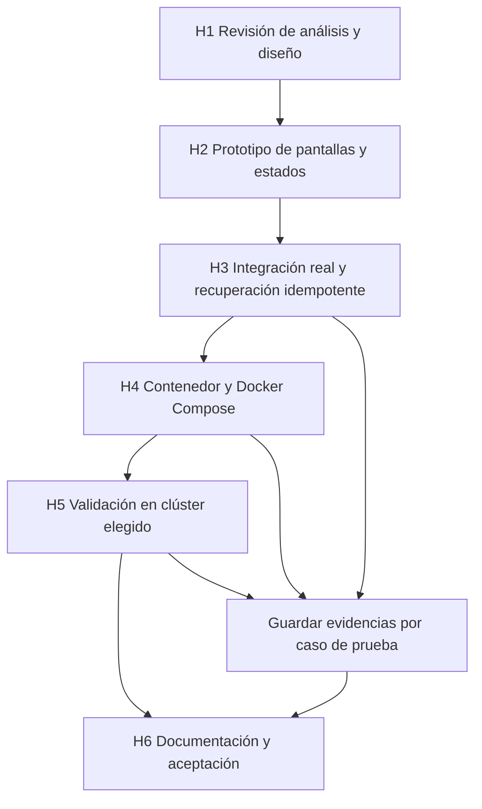

# Plan de validación y entrega del frontend de reservas

Documento DOC-10-05. Etapa 05. Versión 1.0. Fecha 17 de octubre de 2026.

## Propósito y estado

Esta etapa transforma los requisitos en condiciones verificables y organiza la construcción posterior. Todos los casos de prueba de este documento están pendientes de ejecución. Las comprobaciones de documentos y diagramas se registran aparte y no equivalen a aceptación del frontend.

## Trazabilidad

| Requisitos | Caso de uso | Pantallas | Diagramas | Pruebas |
| --- | --- | --- | --- | --- |
| RF01 | CU01 | P01, P02 | D10-01, D10-02 | PV01, PV02 |
| RF02, RF03 | CU02 | P02, P03 | D10-03, D10-05 | PV03, PV04 |
| RF04, RF05, RF06, RF11 | CU03 | P03, P04 | D10-04, D10-07 | PV05, PV06, PV07 |
| RF07 | CU04 | P06, P04 | D10-04, D10-07 | PV08, PV09, PV10 |
| RF08 | CU05 | P05, P04 | D10-02, D10-08 | PV11 |
| RF09 | CU01 a CU05 | P01 a P06 | D10-03, D10-04 | PV02, PV04, PV07, PV08, PV10, PV11 |
| RF10 | CU06 | Todas | D10-03 | PV12 |
| RN01, RN02, RN06 | Todos | Todas | D10-05 | PV13 |
| RN03, RN04 | CU01, CU04, CU06 | P01, P06 | D10-06 | PV14 |
| RN05 | Integración | No aplica | D10-09 | PV15 |
| RN07 | CU03, CU04 | P03, P06 | D10-07 | PV08 |
| RN08 | Operación | No aplica | D10-09 | PV16 |

## Casos de prueba propuestos

| ID | Escenario | Resultado esperado |
| --- | --- | --- |
| PV01 | Acceso con clave válida y catálogo vacío o con eventos | Acceso confirmado y estados diferenciados |
| PV02 | Clave inválida y respuesta 401 posterior | Acceso denegado o solicitud de reingreso; sin fuga de clave |
| PV03 | Lectura de catálogo, selección y actualización | Cupos reales y momento de consulta; sin inventar datos |
| PV04 | Evento eliminado, cupos cero y lectura fallida | Mensajes diferenciados y datos previos marcados |
| PV05 | Cantidades 0, 101, decimal, texto y 1 | Inválidas bloqueadas; 1 llega como entero |
| PV06 | Reserva válida y doble clic | Un registro de intención y un comprobante consistente |
| PV07 | Dos clientes compiten por el último cupo | Una confirmación y un rechazo sin sobreventa |
| PV08 | Perder respuesta después del commit y recuperar | Mismo UUID, un descuento y un evento outbox |
| PV09 | Recargar con pendiente, misma clave y otra clave | Misma clave recupera; otra clave bloqueada antes del POST |
| PV10 | 409 incompatible, 422, 503 y cuerpo no JSON | Error normalizado; pendiente conservado cuando sea incierto |
| PV11 | Consultar UUID propio, ajeno, inexistente e inválido | Datos solo del propietario; mensaje genérico para 404 |
| PV12 | Salir con y sin pendiente | Advertencia cuando corresponde y limpieza confirmada |
| PV13 | Teclado, zoom, móvil, foco y lector de pantalla | Recorrido usable sin pérdida de contenido |
| PV14 | Inspección de bundle, storage, URL y registros | Sin claves persistidas ni expuestas |
| PV15 | Proxy, recarga SPA, ruta API desconocida, UID arbitrario y sondas | Rutas correctas, sin privilegios y fallos controlados |
| PV16 | Carga registrada sobre la topología elegida | Métricas y recursos documentados; capacidad solo si se mide |

PV08 requiere un intermediario de pruebas que deje llegar el POST al servidor y descarte su respuesta; no basta simular un timeout antes de enviar. Las comprobaciones de inventario y outbox se harán en una base exclusiva de pruebas. PV07 y PV08 reutilizarán las garantías existentes del backend, pero deberán verificarse a través del nuevo frontend y proxy.

## Estrategia de verificación

Pruebas de lógica cubrirán validación estricta, normalización de errores y ciclo del pendiente. Las pruebas de integración comprobarán contratos, reescritura del proxy y códigos reales de la API. Un recorrido de navegador comprobará acceso, reserva, recuperación, consulta y salida. La revisión manual completará accesibilidad y distribución de pantalla. Se usarán datos y credenciales de laboratorio separados del entorno de demostración que se quiera conservar.

Cada evidencia incluirá fecha, revisión o hashes del código, versiones, topología, comando, datos iniciales, resultado y limitaciones. Una prueba no ejecutada se mantendrá como pendiente. Una captura aislada no demuestra integridad transaccional, ausencia de secretos ni capacidad de carga.

## Etapas de construcción posteriores

Figura D10-10: dependencias de entrega, fuente `diagramas/fase-10/D10-10-etapas.mmd`. Los hitos son criterios de avance, sin fechas comprometidas.

H1 Revisión del diseño: acordar alcance, pantallas, identidad y recuperación. Salida: registro de cambios y decisiones del usuario. H2 Prototipo: construir pantallas y estados con datos de prueba claramente identificados. Salida: revisión visual sin atribuir funciones al backend.

H3 Integración: conectar operaciones reales y pendiente idempotente. Salida: PV01 a PV12 y PV14 ejecutadas con evidencias. H4 Contenedor y Compose: integrar servidor, proxy y documentación de arranque. Salida: recorrido completo local y parte aplicable de PV15.

H5 Clúster: preparar manifiestos kind y variante OpenShift y verificar UID, entrada y sondas. Salida: evidencia del entorno realmente usado; los entornos no ejecutados siguen pendientes. H6 Cierre: completar PV13 y las validaciones aplicables, actualizar manuales y guion del seminario, revisión Word y aceptación del usuario. PV16 se ejecutará si se pretende presentar resultados de rendimiento; no es requisito para afirmar únicamente funcionamiento básico.

## Riesgos y mitigaciones

| Riesgo | Consecuencia | Mitigación y responsable propuesto |
| --- | --- | --- |
| Respuesta perdida tras confirmar | Duplicación si se genera otra intención | Pendiente congelado y recuperación; implementación frontend |
| Cerrar pestaña con pendiente | Pérdida de clave de operación local | Advertencia y explicación; frontend e instructor |
| Usar otra credencial al recuperar | Nueva reserva bajo otra identidad | Huella local y bloqueo; frontend |
| Exponer una clave en el bundle | Acceso compartido no controlado | Entrada privada y revisión de artefactos; desarrollo |
| Lectura de cupos desactualizada | Expectativa de cupo garantizado | Mensaje informativo y control del servidor; UX y backend |
| Imagen incompatible con OpenShift | Fallo de admisión o escritura | UID arbitrario y validación real; integración |
| Confundir resultados locales con clúster | Conclusiones de capacidad incorrectas | Evidencia por entorno; responsable del seminario |

## Criterio de aceptación de la entrega

Una entrega funcional exige completar una reserva desde navegador, confirmar el UUID y descuento, recuperar una respuesta perdida sin duplicar, consultar solo datos autorizados y salir limpiamente. Debe funcionar desde el origen publicado por Compose, con errores comprensibles, sin claves en artefactos y con evidencia reproducible. La aprobación documental y la aceptación funcional se registran por separado.

## Referencias internas

Fuentes primarias del análisis: `aplicacion/reservas/api.py`, `store.py`, `schema.sql`, `config.py`, `worker.py`, `aplicacion/openapi.json`, `aplicacion/README.md`, `aplicacion/compose.yaml`, `aplicacion/kubernetes/base.yaml` y `aplicacion/openshift/`. Ante divergencias, revisar el código y regenerar OpenAPI antes de implementar. Los documentos de Fases 04, 05 y 09 aportan contexto, sin sustituir pruebas de la nueva interfaz.

## Diagramas editables

### D10-10

